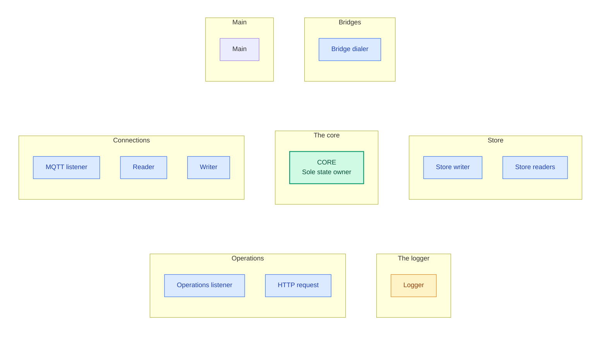
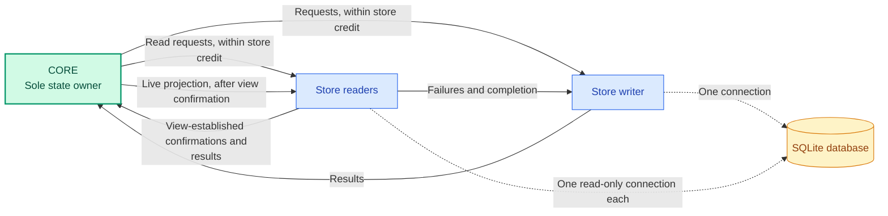
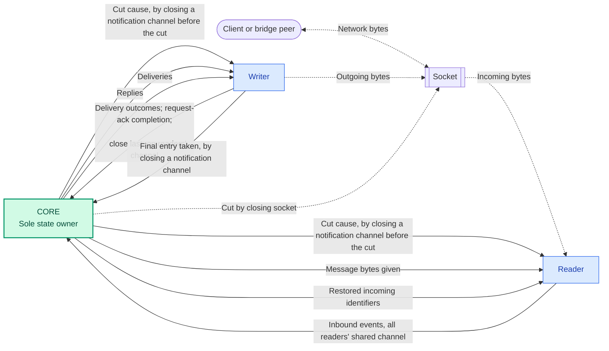
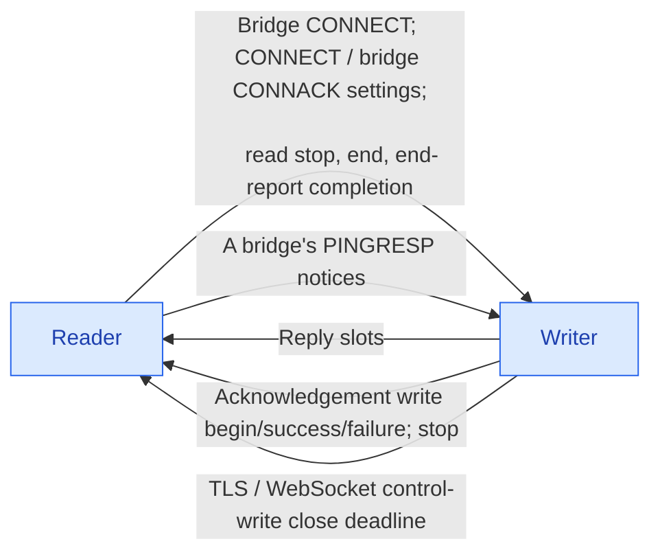
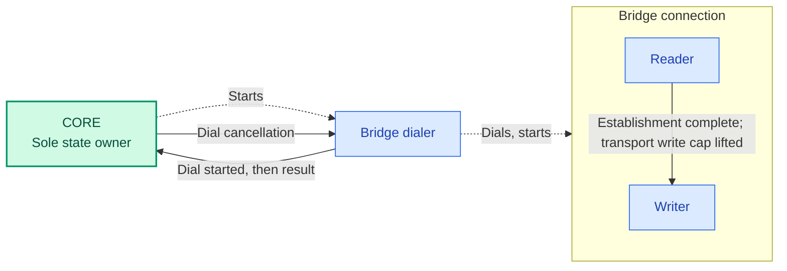
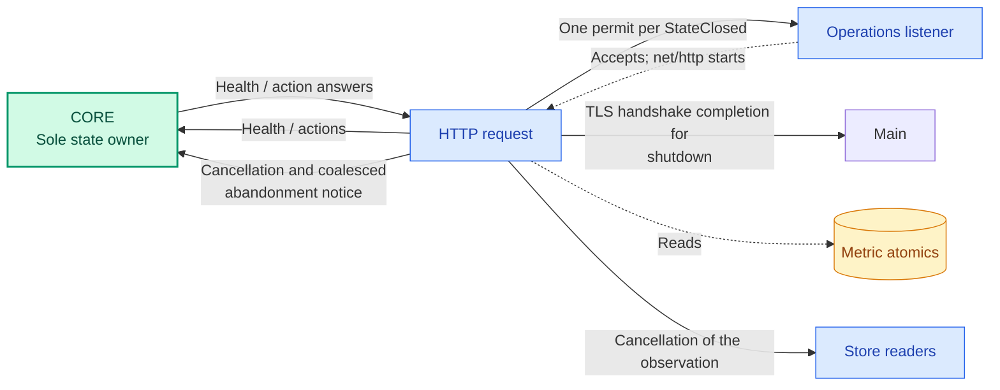
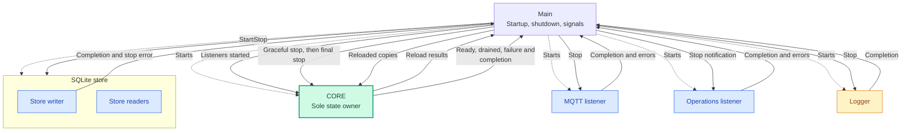
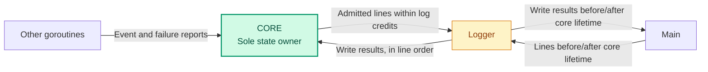

# Sagüin design

Sagüin is a single-node MQTT 3.1.1 and 5 broker built on channels, shipped as
a single binary ([R9](#rules)). This document says what it does, not why.

Each behavioral rule has one normative home. Rules R1–R9 state invariants
and point to their flows ([Rules](#rules)). The configuration document owns
keys, defaults and ranges ([config.md](config.md#sagüin-configuration)). The
metrics document owns observations ([metrics.md](metrics.md#sagüin-metrics)).
The storage document owns representation
([storage.md](storage.md#sagüin-storage)). Those documents refer to behavior
rather than restating it. Backlog comments do not supply additional behavior.

## Rules

Each rule has a test or CI check from the first commit.

- **R1. One owner for all state.** The core alone owns shared broker state.
  The owners and their state and timers are defined in the
  [goroutine table](#the-goroutines-r1) and
  [Execution, State ownership](#state-ownership).
- **R2. The core never waits.** It never blocks on a socket, the store, a
  clock or a log. It sends a request and handles the answer as a later event.
  When work backs up, the clients slow, never the core.
  Execution defines event order, scheduling and capacities
  ([Event order](#event-order); [Ready work](#ready-work);
  [Capacities](#capacities)). The handovers are defined in
  [Store, Requests](#requests), [Flows, Replies](#replies),
  [Logging](#logging) and [Closing a connection](#closing-a-connection).
- **R3. Messages, not locks.** The core talks to other goroutines only through
  bounded Go channels. Ownership transfer and repeatable decisions are
  defined in [Execution, Communication](#communication) and
  [Decisions](#decisions).
- **R4. Stored before acknowledged.** A reply confirming a change waits for
  that change's commit. The replies, their order and their connection are
  defined in [Flows, Replies](#replies). The commit is defined in
  [Store, Writes](#writes).
- **R5. Publishers do not wait for consumer progress.** A publication is
  acknowledged after its channel stores it. Channel entry and admission
  pauses are defined in [PUBLISH](#publish). Progress and loss are defined
  in [Delivery](#delivery) and [Words: Retention](#words).
- **R6. Everything is bounded.** Every resource the broker holds has a limit,
  set by configuration or by the disk, which the core counts.
  What the core keeps is defined in
  [Execution, Resource bounds](#resource-bounds). Connection and message
  bounds are defined in [CONNECT](#connect),
  [Flows, Packet buffers](#packet-buffers), [Delivery](#delivery),
  [Closing a connection](#closing-a-connection) and
  [Message memory](#message-memory).
- **R7. MQTT on the wire, Sagüin's rules on channels.** Every packet follows
  MQTT 3.1.1 and 5, except for the departures in [Channels](#channels),
  [Words: Retention](#words), [Delivery](#delivery),
  [DISCONNECT](#disconnect), [`$saguin` topics](#saguin-topics) and
  [Bridges](#bridges).
  The standards used for testing are linked in [Testing](#testing).
  Sagüin's choices are stated in
  [Choices MQTT leaves open](#choices-mqtt-leaves-open).
- **R8. One SQLite store.** All stored state lives in one SQLite database.
  A store error stops the broker, except a failed memory-mode snapshot.
  The stored state is defined in [storage.md](storage.md#sagüin-storage).
  Storage modes are defined in [Store](#store).
  Recoverable full responses, fatal errors and recovery are defined in
  [Store](#store).
- **R9. Small by rule.** CI rejects an oversized binary or an unapproved
  dependency. The build settings and limits are defined in
  [Testing, Build checks](#build-checks).

### The goroutines ([R1](#rules))

Sagüin starts no goroutine outside this table. Goroutines that Go and its
libraries start for themselves are not counted. Sagüin never uses
`time.AfterFunc` or `context.AfterFunc`, and HTTP/2 is off. Tests fail on
any `go` statement or such call outside the listed functions. They also fail
if the live count of Sagüin's goroutines differs from the table. A WebSocket
connection accepted by a listener has as its reader the goroutine
`net/http` starts for it. That reader starts the connection's writer once
the upgrade succeeds. The WebSocket library, `github.com/gorilla/websocket`,
answers a ping or a protocol error from that reader itself, each such write
within the library's own one-second limit. MQTT output and the orderly close
stay with the writer.

Under TLS, a connection's reader and writer reach the socket through a thin
layer. The WebSocket adapter uses the same layer, also without TLS. The
layer runs in the reader or writer that calls it and passes bytes on
unchanged. The writer publishes the close's one deadline by closing a
notification channel. That deadline is immutable after publication. The
reader observes the notification when its TLS or WebSocket control writes
set a deadline. Once the close has begun, the layer lowers any later write
deadline to the close's one deadline, so TLS's own closing message cannot
extend it ([Closing a connection](#closing-a-connection)). The layer starts
nothing, holds no broker state and takes no lock.

On an operations connection with `proxy_protocol`, that connection's goroutine
reads the PROXY header. Afterwards, the wrapper through which `net/http` reads
only passes bytes on. This also applies to the short read `net/http` starts
per request to notice a hang-up. The wrapper starts nothing, holds no broker
state and takes no lock.

| Goroutine | How many | Lives for | Owns |
|---|---|---|---|
| main | 1 | the process | nothing: starts and stops the others, receives signals |
| core | 1 | the process | all broker state |
| store writer | 1 | the process | its one connection to the database |
| store reader | `read_connections` | the process | one read-only connection; in memory mode, one also writes snapshots |
| logger | 1 | the process | the log output and its write results; lines come from the core, and from main before the core starts and after it ends ([Logging](#logging)) |
| listener | 1 per listener, MQTT and operations | the process | its socket |
| reader | 1 per connection, client or bridge | the connection | its input decoding, inbound aliases, receive quota, rate buckets and input deadlines |
| writer | 1 per connection, client or bridge | the connection | its output encoding, outbound aliases, writes, reply-slot completion and close progress |
| dialer | 1 per bridge connection attempt | the attempt | nothing |
| HTTP request | 1 per open operations connection (`net/http`) | the connection | nothing: metrics read atomic counters; health checks and operator actions ask the core |

**How they talk ([R2](#rules), [R3](#rules)).** Solid arrows are bounded Go
channels. Dotted arrows are not channels.

**Overview: the goroutines grouped by area.**



**Store: the core sends requests and receives results.**



**The core and a connection: bytes, events, replies and deliveries.**



**Inside a connection: the reader and writer coordinate their work.**



**Listeners: the core learns of connections and returns permits.**


**Bridges: the core starts and cancels each connection attempt.**



**Operations: HTTP handlers ask for views and report cancellation.**



**Lifecycle: main starts, reloads and stops the workers.**



**Logging: reports reach the core, and admitted lines reach the logger.**



An operations connection returns its permit at `StateClosed`, including
when main closes it during shutdown. For TLS, the connection's HTTP
goroutine publishes handshake completion by closing a notification
channel. Main observes that notification if TLS shutdown sets a write
deadline.

The operations listener and each operations connection also have a
one-slot channel holding a close token. These channels are initialized
before handover. A caller must take the token before that wrapper closes
its socket. Later calls through the wrapper do nothing. Competing closers
take from the same channel rather than send to one another.

### Testing

The standards are kept in [docs/mqtt](mqtt/), as
[3.1.1 Plus Errata 01](mqtt/mqtt-v3.1.1.md) and [5.0](mqtt/mqtt-v5.md).

Sagüin is tested from outside, as the people who use it see it. A client
observes the wire. An operator observes the command line, exit status, log,
files on disk and `/metrics`. A test inside the code checks only what
neither can see. These checks cover the guards of R1, R3 and R9, the busy
path, and orderings no client can force ([Rules](#rules)).

The busy path is anything run per packet, per message or per connection.
It does no needless work. It makes no second pass over the same data and
avoids every copy or allocation it can. The core's decisions are a function
of its state, one event and that event's time. They return what to do.
The loop around the core carries that out and owns the one real timer.
The core never reads the clock, and a test fails if it does. An inside test
therefore drives it with scripted events and fake times.

Code that reads bytes or text from outside Sagüin is fuzzed, whether the
input comes from clients, a bridge's peer or the operator's files. The broker
as a whole is fuzzed end to end from the wire, with many clients acting at
random. Every answer is checked against MQTT and this document. Each run's
seed is recorded so a failure can be rerun with the same steps. Clients
acting at the same time reach the core in an order that counts as input
under R3 ([Rules](#rules)). The race detector runs on a native glibc build.
A test tool that finds no broker to drive fails, naming the binary.
A run that tested nothing never passes.

A fake broker modelling takeover serializes session ownership, packet effects
and replies. After ownership changes, the former connection performs no
further session work. Its terminal DISCONNECT is its last outgoing MQTT
packet. A deadline test controls or observes the event starting that
deadline. A watchdog bounds the test and is reported separately.
It does not establish a broker timeout. Unrelated work need not finish
before a legitimate deadline. A fuzz run asserting an exact step count disables
successful duration-based termination. TCP-load tests use an overall
watchdog and do not infer a broker write's start from a stalled client
write.

### Build checks

CI fails on a binary of 20 MB or more. This check uses Go's default compiler
and linker settings, plus the flags a static glibc link needs. It uses Go's
own DNS resolver, Go's own user and group lookup, and SQLite's C code
without debug information. Nothing else
is stripped. CI also fails on an unapproved dependency.

## Words

- **Session:** a session is what the broker keeps for a client id. It holds
  subscriptions, positions, in-flight messages and a Will. A session is
  *away* when it outlives its connection, until its expiry. It is *durable*
  when its expiry is above zero. An away session lives in the store alone.
  The core loads it at its CONNECT.
- **Event:** an event is anything the core handles, such as a packet, a store
  answer, a new connection or a timer.
- **Channel:** a channel is a named, typed log holding the topics its MQTT
  topic filter matches. Where filters overlap, the topic goes to the filter
  that spells it out most exactly. Filters are compared level by level.
  The first level where they differ decides. A written level beats `+`
  and `#`, and `+` beats `#`. A filter ending there beats one going on
  with `#`. A `{a,b}` level is expanded first, with each alternative
  treated as a written level. A subscription's filter reaches the channels
  its topics land in. Each topic belongs to its own channel under that rule.
  The filter also reaches `$broadcast` where a matching topic lands in no
  configured channel.
- **Record:** a record is one stored message. It holds an id, time, topic,
  QoS, MQTT properties, payload, offset and the publisher's client id.
  The publisher's client id is used for No Local and is never sent.
  A record on `$broadcast` also holds its retained flags.
- **Offset:** an offset is a channel's counter. The core assigns it when a
  publication enters the channel, in entry order ([PUBLISH](#publish)).
  An offset is never reused, except after a memory-mode crash
  ([Store](#store)). A publication refused after entering leaves its offset
  unused. An offset gap is not a count of lost records. The stored counter
  is raised with every saved record and every saved live-start boundary.
  Startup resumes from that counter. A stored counter below a saved record
  or boundary is a damaged file, and the broker refuses to start.
- **Consumer:** a consumer is a session's subscription to a channel, or the
  position a durable session keeps on it. It has
  a position, or the queue jobs it holds, and a share of the connection's
  in-flight window.
- **Packet identifier:** each connection has two independent spaces of packet
  identifiers, the client's and the broker's. An acknowledgement settles
  only the exchange of its own direction and phase. Receive Maximum is
  counted per direction.
- **Attempt:** an attempt is one try at giving a queue job to a worker.
  It carries a broker-made id as its Correlation Data.
- **Retention:** retention deletes a channel's oldest records by age and size,
  as Kafka does. A record past its channel's retention is gone, whoever
  still needed it: a slow or away consumer, a message sent and not yet
  acknowledged, or one handed back to a shared group. The operator sets
  retention for the consumers the channel must serve. Only a current
  retained value on `$broadcast` stays, until its flag ends by its own
  rules ([Channels](#channels)). The *floor* is the oldest record retention
  has not passed. The *tail* is the next offset. A retained value kept
  below the floor is sent only as a retained value.

  A channel's retention, `$broadcast` included, may pass a record a session
  is owed, even one in its in-flight window. The session continues and the
  loss is counted. This departs from MQTT 5 §4.1 and MQTT 3.1.1 §4.1, and
  from resending an unacknowledged message on reconnect (MQTT-4.4.0-1)
  ([Words: Missed](#words); [Operations, `position-lost`](#http)).

  Age retention becomes due at the earliest applicable record, retained-value
  or tombstone deadline. The core keeps one next age-retention deadline.
  After a pass, it reads the next deadline still to come from the store.
  A committed change brings the deadline forward when necessary. Due work
  follows R2's timer order, with channels ordered by id and records by offset
  ([Event order](#event-order)). Storage delay or refusal follows the store's
  rules ([Store](#store)).

  A channel's records are deleted oldest first, in offset order from the
  floor. A pass reads the times of up to 512 records in one ordered read,
  deletes the run of them past retention in one range, and stops at the
  first record not yet due, whose time sets the channel's next age
  deadline. A record carrying an earlier time than one before it, as after
  the clock is set back, waits behind it: retention deletes late, never
  early.

  A `latest` channel is the exception. There, retention deletes each
  record once it is due, wherever it sits. Nonempty current values expire
  under `retention_period`. Tombstones expire under
  `tombstone_retention_period`.
  The floor is then the oldest record left. A loss counts each deleted
  record a consumer was owed.

  Startup processes overdue retention before serving. Every committed
  change that affects size schedules a size pass for its channel. Periods
  determine when work becomes due. A current retained value is still kept,
  and the store's refusal and retry rules apply ([Store](#store)).
- **Missed:** missed records are those a consumer was owed but never
  received because retention removed them (`retention`) or they were too
  large for it (`too_large`). A loss counts records owed under the
  consumer's filtering, start, seek, No Local and partition rules.
  An offset gap is not a count.

  Retention determines losses before removing the information needed to
  count them. It uses the deletion's ordered boundary. In the retention
  write, the core names its connected consumers and bridge rules, with their
  filters, position, No Local id and partitions. Connected consumers use
  their progress held by the core, including acknowledged progress not yet
  saved. Away sessions use their stored state. An away session's losses are
  counted from its stored subscriptions alone, without the `acl_file`. A
  user who subscribed beyond what it may read can therefore be counted as
  missing records it would never have received. Deliveries already settled
  or handed to a writer are excluded. A retention write deletes at most 512 records.

  The successful deletion answer carries the sum of consumer-record losses
  per channel and exact counts for the connected consumers and bridges
  represented at that boundary. The core applies these counts once. Rollback
  contributes nothing. Processing uses bounded pages and returns no messages
  or payloads. No loss table or column is stored.

  Passing a record counts when retention makes it unavailable to that
  consumer, even if it stays as a retained value. Such a value is deleted
  in the transaction that ends its flag, and that deletion does not count
  it again. A recovered exchange whose record retention has deleted is
  counted as missed (`retention`) when its session resumes, and settled as
  if sent, except on a `latest` channel ([Delivery](#delivery)). That count
  goes to [`saguin_missed_total`](metrics.md#delivery) alone: the reader's
  `position-lost` row keeps the counts of retention's passes. An
  exchange owed only its PUBREL needs no record. Its PUBREL is
  resent and nothing is counted (MQTT-4.4.0-1).

  When a session returns, a takeover included, or a subscription reaches a
  position it kept, and that position is below the floor, the core adds a
  history observation with `last_position` and `last_floor`, moves the
  position to the floor and updates its `last_seen`.
  It adds no reconstructed loss count. That observation does not increment
  the missed counter again ([`saguin_missed_total`](metrics.md#delivery)).
  Counters and histories start empty.

## Execution

### State ownership

One goroutine, the *core*, owns client ids, sessions, subscriptions,
positions, in-flight messages, packet identifiers, Wills, channels and
bridges. It also owns every timer except the following:

- A connection owns its deadlines for `connect_timeout`, the PROXY header,
  keep-alive, the write timeout, the publish-rate wait and the operations
  listener's waits.
- Each MQTT listener owns its accept-rate wait, `max_connect_rate`.
- Main owns its wait for the logger at a graceful stop.

Sagüin's code runs only on the goroutines in the [R1 table](#the-goroutines-r1).
Only the core holds shared broker state. Connection-local state has the
single owner listed in that table. It is not a second copy of shared policy.
The core decides. Readers and writers do everything that needs only their
own connection. This includes decoding and checking packets, compressing
payloads, passwords, keep-alive, publish rates and the `acl_file`, as well
as encoding, outgoing topic aliases and TLS
([Access and reload](#access-and-reload)).

### Communication

Sagüin uses no mutexes. It uses atomics only for metric values and for
swapping in a reloaded copy.

A channel is closed only by its sender. A channel with several senders is
never closed. Its receiver is told to stop on a channel of its own. Once a
buffer is sent, its sender never touches it again. All readers hand packets
to the core on one bounded channel. As its last act, each writer reports
on that channel that its socket is closed. The core does not take from
the channel while it has no store credit. While unresolved publication
batches are at their bound, the core grants no publication body but takes
every other event ([Capacities](#capacities)). Intake stops before the
incoming budget fills, for QoS 0 and QoS 1 alike, in the order of that one
channel.

*Example: a disk that stalls spends the store credit. The core stops taking
packets and the clients slow, while timers and answers carry on.*

The delivery admission gate applies to every client and inbound bridge.
While closed, it withholds new publication body grants
([Capacities](#capacities)). Granted bodies and accepted writes continue.
The gate does not stop other events or work. It does not change store-request
order or reply order ([Requests](#requests); [Replies](#replies)).

### Event order

When several events are ready, the core takes them in this order: stop,
main's reload events, store answers, logger results, the core's timer, then
the readers' channel.
Connections are ordered by listener name and that listener's accept sequence.
Bridge connections are ordered by bridge name. Text keys use their complete
UTF-8 bytes. Channels and stored rules use their ids. Map iteration never
chooses an action.

Equal-deadline core timers run in this order: graceful-stop cutoff,
takeover cut, session expiry, Will publication, queue-hold expiry,
retention, full-store retry, delivery admission, queue retry, bridge
acknowledgement, bridge subscription timeout, bridge redial, commit cutoff,
store sync, metric refresh, snapshot.
Within one kind, the stable owner key decides. During stopping, only work
permitted by the graceful-stop rules runs ([Restart](#restart)).

### Decisions

For the same initial stored state, resolved configuration and ordered inputs,
Sagüin makes the same decisions. Each connection's packet order is preserved.
Independent connections have no common network order. Their order on entry
to the core is their input order, fixed thereafter.

Inputs include operator commands, reported external I/O results, the time
observations specified by their flows, and the explicitly named random draws.
Each source preserves its own order. Priority between ready sources follows
[Event order](#event-order). Internal notifications identify completed work
and do not independently choose its outcome.

Admission, ownership, recipient selection, refusal and transaction membership
follow their stated rules. A read's view and log admission do likewise
([Store reads](#store-reads); [Logging](#logging)). Map iteration, an observed
metric, queue emptiness and Go's choice between ready cases decide none of
them. Time changes eligibility only at a deadline named here. Execution time
and measurements of it may differ without changing these decisions.

### Ready work

The core never leaves work it could do waiting for an unrelated event.
Every unfinished piece of work belongs to an owner: a connection, a
session, a channel, a shared group or the core itself. This includes work
sent to the store or a writer. Work that cannot continue records what must
change before it can.

1. Each change that allows work to continue schedules it immediately:
   applying a store answer, settling a delivery, returning capacity or
   ending a request. Ending, cancelling, refusing or replacing work clears
   its waits and temporary reservations, including marks that a session is
   ending, before its state is reused.
2. After applying the event's results as [Writes](#writes) requires, the
   core works through scheduled work until none can progress, including
   work scheduled meanwhile. Work that cannot progress waits on what blocks
   it, and is looked at again only when that changes. Between outside
   results, work advances through a limited number of steps. Changing lists
   or repeatedly becoming ready and blocked does not count as progress.
   Existing owner order applies. Where no other order is set, older
   eligible requests receive capacity before newer ones. The event's
   actions are returned before the next outside event is taken.
3. Work must leave everything it waits for able to finish, including
   through a chain of waits. Reservations follow [Requests](#requests),
   [Message memory](#message-memory) and [Delivery](#delivery). Store
   answers, writer reports and acknowledgements always have a way through
   that does not depend on the work they release.
4. Scheduling chooses only where [Requests](#requests),
   [Store reads](#store-reads), [Writes](#writes), [Replies](#replies) and
   [Delivery](#delivery) leave a choice. Scheduled work, what it waits on
   and what it holds fit the existing bounds. Nothing scans all consumers
   or stored records to find ready work, and no timer or periodic sweep
   stands in for scheduling. The deadlines this design names remain.
5. Startup schedules its work before it waits for input. A graceful stop
   finishes, cancels or keeps stored each piece of pending work, as
   [Restart](#restart) says. Startup and graceful stop complete only under
   [Restart](#restart)'s rules. Having no ready work is not enough.

### Capacities

The broker uses these internal capacities:

- The inbound event channel holds 64 events.
- Each connection has 64 reply slots and 64 answer allowances.
- A socket write of deliveries holds 16 packets or 1 MiB.
- The store has 1,024 credits.
- Outstanding log entries have 1,024 log credits.
- Due-work and metadata pages hold 256 rows.
- A publication batch holds `publish_commit_max_records` records or 4 MiB
  of message bytes.
- A write group holds one batch bound of publications and 512 other changes.
- Accepted, unresolved publication batches are limited to 4 per channel and
  8 in all. This counts accumulating, sealed and outstanding batches
  together. Commit, refusal or abandonment releases a batch.

These are fixed, not configuration. Each was measured under load and kept.

**Delivery admission.** The core owns one gate and the state for
qualification, progress and peer obligations defined in [Delivery](#delivery).
It keeps at most two progress boundaries per delivery owner.
Pending bookkeeping ages belong to bounded requests and pending owner state.
Peer deadlines belong to bounded active exchanges.
The core keeps no timestamp per unselected record.
Updates use owner events and indexed deadlines.
They never scan all consumers or stored records.

A boundary's delay is elapsed broker-wait time from the core event making
its first work available. Pending bookkeeping starts counting when its
inputs and predecessors permit it to proceed. Waiting for broker work,
including storage, counts. Peer-dependent intervals do not count and do
not restart accumulated delay. Changing delivery stage, promoting a
boundary or coalescing changes preserves the oldest unfinished work's
delay. A commit retires only the work it confirms.

The admission delay is the greatest contributing delay among qualified
owners' serviced boundaries and pending bookkeeping.
No contributing work means zero delay.
A full refusal preserves the age of logical work retained for retry.
Its retry wait counts as broker delay.
Work discarded under those rules contributes no further delay
([A full disk](#a-full-disk)).

The gate closes when the admission delay reaches
[`delivery_admission_delay`](config.md#broker). Once closed, it opens when
every contributing delay is below half that value, or no qualifying work
remains. Between those thresholds its state is unchanged. It starts open,
remains open when disabled, and ends its closed interval when stopping begins.

The core evaluates qualification and the gate after applying an event's
results and before granting a publication body. It also evaluates them at
the next admission or peer-obligation deadline, using its existing timer.
Due peer-obligation deadlines are applied before the gate thresholds.
Timestamps come from the core's event times.
Metrics and store execution measurements never control the gate.

### Resource bounds

The core keeps state, never a payload at rest.

The configured limits bound what the core keeps. It holds connected sessions
up to `limits.max_connections`. Each session has subscriptions bounded by
`limits.max_subscriptions` and `limits.max_topic_length`, an in-flight
window bounded by `limits.max_inflight`, and held QoS 2 identifiers bounded
by `qos2.max_inflight_per_client`. The core also holds the configured
channels and bridges. A connected durable session may keep a position on
every `append` channel and queue. A position no subscription reaches has no
scan or page of its own, and never holds publishers back.

Retained-value and queue metadata at rest remain in the store. The core
holds active exchanges and bounded metadata pages. It holds at most one
page per store reader, regardless of a consumer's window. The row bound is
defined in [Capacities](#capacities). A page is read for a channel
and serves every consumer of that channel whose scan it covers. A consumer
it does not cover waits for that page's answer. A retained-value page is
shared only by consumers admitted in the same core event.

Startup obtains counts and next deadlines without loading every retained
value or unfinished job. A Will, a held QoS 2 message and a record in flight
stay in the store and are read when needed. An away session is in the store
alone, bounded by the disk ([CONNECT, Load](#connect)). Bytes in transit
follow the message-memory rules ([Message memory](#message-memory)).

## Channels

A retain flag on a configured channel topic is ignored (MQTT-3.3.1-5). A
consumer's position follows the channel's retention ([Words:
Retention](#words)). Message Expiry follows [Delivery](#delivery).

- **`append`** is a Kafka-like topic with delete retention. A consumer
  behind the floor jumps to it. Only the records it was owed are counted as
  missed ([Words: Missed](#words)).
- **`latest`** is a Kafka-like compacted topic. It holds one value per topic,
  replaced in place at a new offset, in one write
  ([storage.md, `records`](storage.md#records)). An empty payload deletes the
  value and leaves a tombstone. Values and tombstones follow
  [Words: Retention](#words). Returning consumers receive surviving
  tombstones as empty payloads.
- **`queue`** provides Kafka-like share groups. Its records are stored like
  `append` records, and acknowledged jobs stay for readers. A subscription
  to `$saguin/queue/<channel>` at QoS 1 makes a *worker*. Each job goes to one
  worker at a time. A subscription to the channel's own topics makes a
  *reader*, as on `append`. The two need separate permissions, `consume`
  and `read`.

  Retention never deletes an unfinished job, except one too large to
  dead-letter, as described below. It moves the job to the `append`
  channel `<channel>__dlq` in one transaction. The topic gains the prefix
  `__dlq/`, whatever the queue's filter.
  *Example: `orders/a/42` becomes `__dlq/orders/a/42`.*

  The moved job carries `saguin-dlq-reason`. Its value is `expired` when
  the job is past `retention_period`, `evicted` when
  `retention_bytes` causes the move, or `attempts_exhausted`
  ([Delivery](#delivery)). When several dead-letter causes apply,
  `expired` wins, then `attempts_exhausted`, then `evicted`.
  A dead-letter topic may exceed the topic limits by its prefix. A job
  whose properties, with the `saguin-dlq-*` ones added, would exceed MQTT's
  largest Property Length is not moved. It is discarded, logged and
  counted as missed (`too_large`). A held job moves when its hold ends.
  Held jobs do not count toward `retention_bytes`, so a queue never
  refuses a publish for being full.

  The dead-letter channel's filter is the queue's filter with the same
  prefix. Its readers start at the floor. A dead letter's age, for that
  channel's retention, counts from the move. Its Message Expiry stays as
  it was published. Only the broker writes to it, and a
  publish gets 0x87. An `acl_file` rule names it `<channel>__dlq`, as an
  `append` channel allowing read and seek, never write.
- **`$broadcast`** is the reserved `append` channel for every topic no
  configured channel claims. It follows MQTT, subject to the reserved
  `saguin-` prefix and the departures named in [R7](#rules).
  - Every message goes in, whatever its QoS. QoS decides only when a message
    enters and caps the QoS it is delivered at.
  - Each session has one cursor, stored if durable.
  - **Retained** is a flag, not a copy. A record keeps *published retained*,
    MQTT's RETAIN bit, which never changes. It also keeps *current retained
    value*, which applies to at most one record per topic. A retained publish
    takes the flag. A plain publish leaves it. An empty retained publish
    clears it. A retained value ends only by losing its flag to a newer
    retained publish, an empty one, its Message Expiry or
    `retained.retention_period`, measured from the publish.

    Retention counts only unflagged records toward its size. Retained values
    have their own size limit. A value that does not fit is refused with
    0x97. Where `retained.max_bytes` is set, each topic's charge against it
    is the largest of its committed current value and its accepted pending
    replacements, including held QoS 2 replacements. The retained limit
    counts the sum of those topic charges. A proposed replacement is admitted
    if that sum, with its proposed charge included, fits. A committed
    replacement releases the preceding value's charge only to the extent
    that no remaining pending replacement needs it. Refusal or abandonment
    releases that replacement's reservation.

    RETAIN is 1 on retained values sent to a new subscription.
    Otherwise it is 0 unless Retain As Published.

A hard byte limit counts committed charges and reservations for accepted
writes. A pending deletion releases no charge before commit. A replacement
reserves its increase under the applicable replacement rule. Retained values
follow their own reservation rule ([Channels](#channels)).

## Store

The database is SQLite through `github.com/mattn/go-sqlite3`, linked
statically. It runs in WAL mode, with `synchronous=FULL` except in
`normal` mode. Each write claims the database as it starts
(`_txlock=immediate`), including any reads it makes first. Readers are
unaffected. SQLite syncs with `fdatasync`, which keeps that guarantee.
SQLite manages its own log and folds it into the database by its own
default rule. Sagüin only sets `journal_size_limit` to 4 MiB at open, so
the log shrinks back after a burst. Sagüin never folds the log itself,
except for the checkpoint that memory-mode startup makes before closing
the disk database, and the one each memory-mode snapshot begins with.

The store closes its readers first and its writer last. At a stop in
`full` or `normal` mode with no store error, SQLite folds the log into the
database as the last connection closes. No `-wal` or `-shm` file remains.
The `file_path` is always the database on disk.

Through `database/sql`, each store goroutine keeps its connection for life
with `DB.Conn`. Each has one connection. Settings are in the connection
string, and no call is cancellable. A broken connection is a store error.
It is never retried on another connection. Each statement of the store's
operation table is prepared at startup on every connection that uses it.
If a statement cannot be prepared, startup is refused.

A store reader hands a stored payload on as the driver gives it, without
copying it again. The driver gives each row's payload a copy of its own,
which nothing reuses once the read moves on or ends. This holds for the
pinned driver, not by `database/sql`'s contract, and a test fails if a
driver version reuses that copy.

The writer takes what is waiting in a fixed order: stop, a reader's failure,
then writes. Reads go to the store readers only. Every SQLite table, with
its columns, keys and indexes, and the schema version, is defined in
[storage.md](storage.md#sagüin-storage).

- **`full` mode** runs on `file_path`. The default mode is defined in
  [config.md, `broker.storage`](config.md#brokerstorage). Everything
  acknowledged survives a crash or a power cut. A restart recovers
  committed state.
- **`normal` mode** runs on `file_path` with `synchronous=NORMAL`. Every
  `sync_interval`, counted from the end of the previous sync, the core's
  timer asks the writer for a sync if anything was committed since. The
  request takes its place in the store-request order like a write. The
  writer syncs the log file itself (`fdatasync`), which writes to the disk
  only the commits since the previous sync, whatever reads are open. SQLite
  folds the log by its own rule, as in `full` mode. A failed sync is a
  store error. A crash of the broker loses nothing acknowledged. A power
  cut or a crash of the operating system loses at most the commits since
  the last completed sync.
  A restart recovers what reached the disk.
- **`memory` mode** validates `file_path` at start and lets SQLite recover
  its committed log. It then checkpoints the disk database and copies its
  file, byte for byte, to `<id>.db` in `memory_dir`, named after
  `broker.id`. This RAM copy is readable and writable by the broker's user
  alone (0600). Startup first takes a live exclusive lock on `<id>.db.lock`
  beside it, as the storage lock is held. If another process holds it,
  startup is refused, naming the lock. A start replaces any RAM copy left
  there, since a restart recovers from `file_path`. Startup closes every
  connection it opened to the disk database and runs on the RAM copy.
  An incomplete checkpoint refuses startup. A refused start deletes the
  RAM copy it made, then releases its locks. Sagüin never deletes a log
  holding commits not yet checkpointed.

  A missing `file_path` is first created as in `full` mode, then copied
  like any other. A missing `memory_dir` is created, readable only by the
  broker's user (0700). The `memory_dir` must be a tmpfs, which startup
  checks. macOS is refused.

  Every `snapshot_interval` and at a graceful stop, a snapshot copies the
  RAM copy's database file, byte for byte, to `file_path.new`, beside
  `file_path`. It gives that file `file_path`'s mode, owning group and
  access control list (ACL), so the read access an operator granted on
  `file_path` survives the snapshot. It then syncs that file, renames it
  over `file_path` and syncs the directory. The disk therefore needs room
  for a second copy of the database while a snapshot runs.

  A process can give a file only a group its user belongs to. Startup in
  memory mode is therefore refused when `file_path`'s group is not one of
  the broker's user's groups. The refusal names `file_path`, its group,
  and the two ways to grant the access instead: add the broker's user to
  that group, or name the group in `file_path`'s ACL.
  *Example: `file_path` is in group `backup`, and the broker runs as
  `saguin`, which is not a member: the broker does not start.*
  When `file_path`'s group changes while the broker runs to one it cannot
  give, the snapshot still replaces `file_path`, with its mode and ACL,
  and the broker logs one WARN line naming `file_path` and the group it
  could not keep. The new file then has the broker's own group, so later
  snapshots keep that group and log nothing about it. *Example: an operator
  gives `file_path` group `backup` while the broker runs; the next snapshot
  logs that it could not keep `backup`, and the snapshots after it are
  silent.*

  A snapshot request takes its place in the store-request order like a
  write. It holds exactly the commits before it. At its turn, the writer
  folds the whole log into the database file (a `TRUNCATE` checkpoint),
  then a store reader opens a read, which keeps SQLite from changing that
  file. Writes then resume and collect in the log while that store reader
  copies the file. Later writes are not held: they belong to a later
  snapshot. Snapshots never overlap. Each `snapshot_interval` is counted
  from the end of the previous snapshot.
  A snapshot, the final one included, is skipped when nothing was
  committed since the last successful one. A failed snapshot is therefore
  tried again at the next interval. The RAM copy is still deleted at a
  clean stop. The core sends the final snapshot as its last store request.
  A stop that arrives while a snapshot runs takes its final snapshot after
  that one ends. A snapshot has no size limit, so the operator gives the
  service manager's stop timeout room to copy the whole database.

  A fold that cannot complete for room in `memory_dir` fails the
  snapshot. The log keeps every commit.
  A read held on the RAM copy from outside the broker delays the fold by
  up to five seconds and fails that snapshot.
  A failed or interrupted snapshot leaves `file_path` holding either the
  previous complete snapshot or its complete replacement. A leftover
  `file_path.new` is removed before the next attempt. Success is reported
  only once the rename and the directory are safe on disk.

  A restart in memory mode recovers the whole store, offsets included, from
  `file_path`, so clients deduplicate on `saguin-id`, not `saguin-offset`.
  A failed snapshot is logged and counted, and makes `/health` unhealthy.
  A snapshot failure at a graceful stop exits with an error naming the
  RAM copy, and leaves it in place. A stop for a store error takes no final
  snapshot. It exits with an error naming the RAM copy and leaves it in
  place. A stop for any other failure takes its final snapshot. A clean
  stop deletes the RAM copy once the final snapshot succeeds.
- A damaged `file_path` stops the broker. If the damage is in the header,
  schema, version or state the core loads, it stops the broker at startup.
  Otherwise it does so when first touched ([R8](#rules)). A start that
  refuses the database file leaves it, and a `-wal` file beside it, as it
  found them. SQLite may create an empty `-wal` and its `-shm`.
  An existing database may switch between modes.
- **The lock:** the running broker holds a live exclusive lock on
  `<file_path>.lock` beside the database. The file's existence does not
  hold the lock. A missing database file is created 0600, readable and
  writable by the broker's user alone, whatever the umask, and so is the
  lock file. SQLite gives the database's `-wal` and `-shm` the database
  file's mode. The broker never changes the mode, group or ACL of a file
  that exists, so an operator grants others read access through the
  file's own permissions or ACLs. A memory-mode snapshot replaces
  `file_path` with a new file that keeps all three, as `memory` mode
  above describes.
  A broker that finds the lock held by a live process refuses to start,
  naming the lock. A lock file left by a crash is an ordinary file.
  The drop-channel command takes the same lock
  ([`saguin --drop-channel`](#operations)).

### Requests

Each dispatched read and each dispatched write group consumes one store
credit until its answer is processed. A group's members consume no separate
credits. Answers return on the bounded answer channel, which is always
drained. Each session, shared group and channel keeps at most one request
of its own in flight, plus bounded pending work.

A consumer keeps at most one request of its own, either a read or its
session's subscription change. Alongside it, the consumer may have at most
two writes of delivery bookkeeping. One saves its new exchanges and the
other saves its progress and settlements. A single write may do both.
The consumer may also have bounded pending work. These writes start only
while its own request, if any, is a read of channel records.

Outstanding means dispatched and not yet answered. Pending work remains
owned by the core and charged to its message, reply-slot and metadata
budgets. A publication list is charged work. A request affecting several
owners reserves them together. It checks every owner it needs before
reserving any. Applying a predecessor's result schedules its dependent
request. Other requirements may still make it wait
([Ready work](#ready-work)). Unrelated owners continue.

A request never waits for one placed after it in the store-request order.
A request waiting for its predecessor holds back only its own owner's later
requests. A read other than of channel records still follows earlier accepted
writes ([Store reads](#store-reads)). A takeover does not await the reads of the
connection it replaces. Those reads are superseded, and their results have
no further effects ([Store reads](#store-reads)). The takeover still follows
that connection's writes and its writer's reports ([CONNECT](#connect)).
Grouping is defined in [Writes](#writes).
Read barriers are defined in [Store reads](#store-reads).
Store credit is defined in [Execution, Capacities](#capacities).

### Writes

The core keeps at most one write transaction outstanding at the store.
Publications, session saves and endings, positions, Wills and other writes
may share a group. Eligible writes join in their store-request order,
within the read boundaries ([Store reads](#store-reads)). A write awaiting
its owner's earlier request or another required predecessor stays pending.
It does not hold back unrelated eligible writes. A write is accepted when
it joins a group. Until then it is pending.

With no `publish_commit_interval`, the core seals eligible pending work at the
end of the current core event whenever no write transaction is outstanding,
before taking another event. After a transaction answer, it first applies
every member's result. Empty groups are not sent.

A Store-read barrier seals the earlier pending writes it covers. A read of
channel records is no barrier. Later changes cannot join those writes or their
groups. Covered writes must be resolved before the read fixes its view. Later
writes may proceed after the view-established confirmation, without waiting
for the read to finish. These boundaries follow [Store reads](#store-reads).

With a configured interval, every kind of eligible write joins the collecting
group. Its first publication fixes the core's collection deadline
([R1](#rules)). The group is due at that deadline, or at the end of the event
in which a write that is not a publication joins it. A due group keeps
gathering until it can dispatch under the store-credit, sealed-group order
and Store-read rules, unless a record limit, barrier or stop seals it first
([Store reads](#store-reads)). It seals and dispatches at the end of the
first event permitting dispatch, after every member result of a transaction
answer has been applied. A non-publication write adds no wait for the
collection deadline.

A batch closes before either of its limits would be exceeded
([Capacities](#capacities)). One otherwise valid publication larger than
the byte limit forms a batch alone, fully charged. Reaching a group's limit
seals it at once, before a write that would take it past that limit.
A Store-read barrier or a stop also seals it at once
([Store reads](#store-reads)). A write is never split. A publication batch
closes only at its record or byte limit, a Store-read barrier or a stop.
Other requests queued between its publications do not close it. Once a
batch has closed, a channel's next publication starts another batch, which
waits its turn. Replies for stored changes keep their packet order across
batches.

Sealed groups dispatch in order and never gain members while awaiting the
write slot. Stop ends collection delays and drains accepted work under the
[shutdown rules](#restart).

Outstanding, sealed and accumulating work together obey the bounds on
messages, owner state and metadata pages ([R6](#rules)). Grouping copies no
bodies and permits no accumulation of additional metadata pages beyond those
bounds.
The limits hold with or without an interval.

The writer executes exactly the sealed group as one transaction and returns
one transaction result. Consecutive members changing the delivery bookkeeping
of different sessions may be combined into shared statements. Any other
member, or a later member for the same session, keeps its place in member
order. The core applies every member's result before taking another event.
Success follows commit, and acknowledgements follow [R4](#rules).

A full refusal rolls back the whole group and answers every member "full",
including members not executed. Each follows its existing refusal or retry
rule. Other errors follow [R8](#rules). After a store error, the writer
applies no further write. Every write still queued, and every later one,
is answered with that first error. A store error is reported once, in the
answers that carry it. The store's stop reports only an error no answer
carried.

The first event making a group due or sealing it fixes its commit cause:
`event` for dispatch without a collection delay, `interval` for the collection
deadline, or `max_records`, `barrier` or `stop` for those boundaries. Later
events do not change the cause. Ready-event priority follows [R2](#rules).
Cross-channel grouping performance is unmeasured. Record limits and read
barriers can require more than one transaction.

### Store reads

A read of channel records names only offsets the core has seen committed.
Such a read covers a page of record metadata or record payloads, but not
a page of retained values. It has no place in the store-request order.
It holds back no write and is answered once. If retention removes a record
before the read reaches it, the record is skipped for that consumer.
Retention counts its loss once ([Words: Missed](#words)).

Every other read used for a broker decision has a place in the core's
store-request order. Earlier accepted writes are resolved before its view
is fixed. Later writes wait until the reader confirms that its read
transaction has established that view. Beginning a deferred transaction
alone is not that confirmation. Later writes may then proceed while the
read finishes.

Independent owners have no request order between them. R2's lanes and this
section's barriers supply the only orders ([R2](#rules);
[Store reads](#store-reads)). Their results are applied in the core's event
order. Each owner's request order is preserved, as is the connection reply
order ([R4](#rules)). Before applying a result, the core checks whether its
requesting owner and connection still exist and still own that request.
An ended or superseded request has no further effects. Reconciliation does
not substitute a newer database view for the fixed one.

### Compression

Compression applies to stored payloads: channel publications and Wills.
`$saguin` request bodies are never stored and are not compressed.

A payload over 4 KiB, SQLite's page size, is compressed with S2 and stored
compressed only where that makes it shorter
([storage.md, A stored payload](storage.md#sagüin-storage)). The connection's
reader compresses the payload, including a Will's payload, before handing
it to the core. A store reader decompresses it once per read, whatever the
number of recipients. The core interprets only the payload as received.
It carries any prepared stored copy opaquely to the store. The connection
writers handle only the payload as received. Retention, the size limits and
the Maximum Packet Size checks count the payload's size as received.
The memory this takes follows [Message memory](#message-memory).

### A full disk

A full disk is an operational fault for the operator to fix. While it
lasts, Sagüin cannot keep every promise in this design; it limits the
damage by the rules below.

On a full disk or a full `memory_dir`, a write is answered "full" only when
SQLite reports lack of space and rollback confirms that the transaction did
not commit. The broker continues after that answer. A failure whose
transaction outcome or database integrity is uncertain is a store error.
It stops the broker, even when lack of space caused it.

The store has no size limit of its own. Each channel, `$broadcast` and the
retained values have their own limits. State without a limit, such as a
`latest` channel or sessions, is bounded by the disk. The operator sizes
the disk.

Group refusal follows [Writes](#writes).
Publishes are refused with 0x97. Changes made by CONNECT, SUBSCRIBE or
UNSUBSCRIBE are refused with that packet's code. A write request answered
"full" is discarded. The core does not retain its body for retry. It may
retain bounded bookkeeping under the following rules.

For a connected consumer's position save, the core retains its latest
position as one bounded dirty mark. A full refusal leaves that mark dirty.
The next successful opportunity saves the latest position. Intermediate
positions are not queued. If the consumer leaves memory first, unsaved
progress is lost and recovery uses its stored position.

A full refusal also keeps the bounded bookkeeping for
[inherited settled markers (phase 3)](storage.md#session_inflight) and shared
groups under [Delivery, Positions](#delivery).

The following applies when no bounded bookkeeping preserves the change.
What a lost write would have changed comes back only from what the store
still holds, from the client's own resend, or at the next start. The next
sweep or retention pass may rediscover a due Will or session, or a record
not yet deleted. Anything else is gone.
A start with no room for SQLite's `-wal` and `-shm` files is refused,
naming the cause.

A housekeeping write refused for room sets a retry deadline one second after
that answer. An existing earlier retry is not postponed. At the deadline,
the core rediscovers due Wills, session endings and retention work from the
store. From its own state, it retries connected consumers' dirty-position
marks and their deliveries left unsent by a refused save. Failed write
bodies are not retained. The retry also covers the retained marker and
shared-group bookkeeping ([Delivery, Positions](#delivery)). Another full
refusal schedules the next retry.
A successful earlier opportunity may save a dirty position under the
dirty-position rule ([A full disk](#a-full-disk)). Stop cancels the retry.
Restart rediscovers work held in the store. The retry covers the writes
the sweep makes.

## Sagüin properties

Sagüin adds these User Properties to deliveries to clients from configured
channels. Deliveries to clients of messages on `$broadcast` carry none of
them. They receive only MQTT's own per-delivery changes to Message Expiry,
RETAIN and Subscription Identifiers. The publisher's own User Properties go
unaltered (MQTT-3.3.2-17). What a bridge sends its peer follows
[Bridges](#bridges).

The `saguin-` prefix is reserved on every topic. A publish carrying any
`saguin-` property except `saguin-id` is refused with 0x83.
The `saguin-id` property sets the record's id ([PUBLISH](#publish)).
A publish carrying `saguin-id` twice takes the first. A publish whose
`saguin-id` is already stored makes a second record. Nothing a publisher
sends is altered, except that a queue job's Response Topic and Correlation
Data are the queue's own. MQTT 3.1.1 clients receive none of these properties.

| Property | On |
|---|---|
| `saguin-id`, `saguin-offset`, `saguin-timestamp` | every delivery |
| `saguin-expires` | where the publisher set an expiry |
| `saguin-channel` | where the consumer's filter reaches more than one channel |
| `saguin-attempt` | queue jobs sent to workers |
| `saguin-dlq-*` | dead letters: `saguin-dlq-reason`, `-channel`, `-offset`, `-attempts`, `-at`, and where an attempt was spent `-first` and `-last` |
| `saguin-unread` | an UNSUBACK, naming a `saguin-` property the UNSUBSCRIBE carried that Sagüin does not read |

The value of `saguin-id` is the publisher's own where it set one, kept as
sent. Otherwise the broker makes a UUIDv7. The values of `saguin-offset`,
`saguin-attempt` (from 1), `saguin-dlq-offset` and
`saguin-dlq-attempts` are decimal. The values of `saguin-timestamp`,
`saguin-expires`, `saguin-dlq-at`, `-first` and `-last` are Unix
milliseconds in decimal. Here, `saguin-dlq-at` is when the job moved,
and `-first` and `-last` are its first and last attempt.
The values of `saguin-channel` and `saguin-dlq-channel` are channel names.

## `$saguin` topics

A request is a publish. Its answer is a QoS 0 PUBLISH queued as a delivery.
The answer goes only to the asking connection, on its Response Topic with
its Correlation Data ([Delivery, Service publications](#delivery)).
A request without a Response Topic is refused with 0x83, except for a seek
or a queue response ([PUBLISH](#publish)). A publish under `$saguin/`
naming no request is refused with 0x90 without consulting the `acl_file`.
Only the topics the table marks subscribe can be subscribed to.
Any other filter under `$saguin/` is refused with 0x87, as `$SYS/` is
([Operations, HTTP](#http)). A filter under `$saguin/queue` that names no
worker topic is the exception: it is refused with 0x8F
([SUBSCRIBE](#subscribe)). MQTT 3.1.1 gets 0x80 for both.

An MQTT 3.1.1 client cannot be a worker and is refused with 0x80 if it tries.
It cannot make a request needing a Response Topic, except for a seek, which
is answered on its reply topic. It may publish into any channel, queues
included.

A worker session connected over MQTT 3.1.1 gets no offers. Its subscription
stays. Offers resume when it connects over MQTT 5.

| Topic | Use |
|---|---|
| `$saguin/consumer/<channel>/seek` | moves this durable session's position on an `append` channel (a dead-letter channel included), or a reader's on a `queue`, with `seek` on that channel (else 0x87); a session may seek before it reads the channel, a saved seek position controlling the first read of that channel, a position so made staying with the session until the session ends ([UNSUBSCRIBE](#subscribe)). Payload: `0` (the floor), `-1` (the next offset), an offset, a duration ago (`12h`) or an RFC 3339 time, read as the [seek rules below the table](#saguin-topics) say; any other form is `malformed`. Answer: the new offset; or `no-session` (the session is not durable), `malformed`, `below-floor` (User Property `saguin-floor`: the floor) or `beyond-end` (`saguin-next`: the next offset), each also 0x83 on the PUBACK (MQTT 3.1.1: an ordinary PUBACK, the answer carrying the reason, and the connection stays). Taken at QoS 0 too, a refused one dropped. Any other channel or name: 0x90 |
| `$saguin/consumer/<channel>/seek/reply` | subscribe: the seek's answer, when no Response Topic was set |
| `$saguin/kv/get` | The request reads one topic's current value on a `latest` channel. It needs `read` on that topic (else 0x87). The payload is the topic. An empty answer means no value. The answer carries the request's Correlation Data, or the topic where it set none or an empty one. The broker refuses a topic on no `latest` channel, with a wildcard, under `$`, or over `max_topic_length` or `max_topic_levels` with 0x90. It refuses an empty payload with 0x83. At QoS 0, the request is dropped. |
| `$saguin/queue/<channel>` | subscribe, at QoS 1: become a worker |
| `$saguin/queue/<channel>/response` | `ack` or `return` a job, with its attempt's Correlation Data. Needs `consume` (else 0x87). No answer: the PUBACK (0x00) confirms receipt only. A response naming an attempt that is not current or not this session's, or with another payload, changes nothing and is logged. Taken at QoS 0 too |
| `$saguin/catalogue/<channel>` | The answer describes a channel: `{"name":…,"type":…,"filter":…,"verbs":[…]}`. The filter is as configured. The verbs are those of the asker's grants that name the channel. Each operation is still checked against its own topic. A queue adds `"pin"`, its worker topic `$saguin/queue/<channel>`. A channel that does not exist, or on which the asker holds no verb, gets an empty answer and PUBACK 0x00. Correlation Data follows [`kv/get`](#saguin-topics), with the channel name standing for the topic. At QoS 0, the request is dropped. |
| `$saguin/sessions/disconnect` | An operator disconnects the client whose id is the payload (0x98). Its session is kept. The request needs `sessions: disconnect` (else 0x87). The answer is `hung-up`, or `no-such-client` where no connection has that id or it is already closing. The broker refuses an empty payload or the asker's own id with 0x83. At QoS 0 it still acts. A refusal at QoS 0 is dropped. |

**Every request** taken at QoS 2 runs on arrival, as at QoS 1.
If the request changes something, its PUBREC waits for the store to
confirm that change ([Replies](#replies)). The ordinary PUBREL and PUBCOMP
follow. Its identifier is held and counted against
`qos2.max_inflight_per_client` like any other incoming QoS 2 exchange's
identifier ([PUBLISH](#publish)). Nothing about the exchange is stored.
After a reconnect, its PUBREL therefore gets PUBCOMP 0x92, as for any
unknown identifier, although the request has already run
([PUBLISH](#publish)). Not keeping this exchange across connections departs
from MQTT 5 MQTT-3.1.2-23 and MQTT 3.1.1 MQTT-3.1.2-4.

A refusal at QoS 2 is carried on PUBREC as it would be on PUBACK.
An MQTT 3.1.1 client receives an ordinary PUBREC, with the answer carrying
the reason. Each row's own QoS 0 rule applies.

A connection has a bounded number of answer allowances
([Execution, Capacities](#capacities)). Before the broker carries out a
request that has a direct answer, the request takes one of them, after its
other admission checks. When none is free, the request is refused without
being carried out: PUBACK or PUBREC 0x97 on MQTT 5, and dropped at QoS 0.
An MQTT 3.1.1 seek refused this way has no answer to carry the reason, so
it is disconnected at QoS 1 or 2, as any refused publish is
([PUBLISH](#publish)).

An accepted request's acknowledgement becomes ready when its checks pass
and any change it makes has committed ([R4](#rules)). A disconnect
request's acknowledgement becomes ready when its action is taken. It never
waits for the answer to be prepared or delivered. It is sent in the order
[Replies](#replies) gives. The request's reply slot follows the ordinary
rule in [Replies](#replies). A request at QoS 0 keeps none.

An answer's allowance ends when the answer is handed to the writer or
discarded. A direct answer reserves outgoing memory and delivery-queue
space before loading its body, and otherwise waits as the connection's
deliveries do. It consumes no QoS 1/2 send quota. An answer known to
exceed the client's Maximum Packet Size is discarded before it takes a
delivery descriptor. Any other answer exceeding it is discarded. One
descriptor within the connection's twice-window bound is reserved for
direct answers. A lost or discarded answer never undoes a completed
request.
Each request receives one terminal result
([metrics.md, `saguin_requests_total`](metrics.md#publishing)).

**A `kv/get`** reads the value's size first. The core reserves outgoing
memory for it, then the value is loaded ([R6](#rules)). A value replaced in between
by one that fits the reservation is answered at once. A larger one makes
the load report its size, and the request reserves again for that size,
so the answer is the newest value. A value deleted in between gets the
empty answer.

**A seek** requires a durable session, not an existing consumer. An explicit
seek may replay before a subscription's live-start boundary. Outstanding
exchanges finish under [Delivery](#delivery). Deliveries on that channel
prepared but not yet handed to the writer are cancelled. Their stored
preparations are removed in the seek's transaction. Reading resumes from
the new position.

A seek first applies the ordinary PUBLISH admission policy checks in the
order of the [PUBLISH refusal table](#publish). Its own refusals then follow
in this order: `no-session`, `malformed`, and `below-floor` or `beyond-end`.
An answer on `…/seek/reply` carries the request's Correlation Data, as one
on its Response Topic does. A subscription to `…/seek/reply` is granted at
the QoS asked, whatever the `acl_file` says. It only ever carries the
subscriber's own answers.

Surrounding Unicode whitespace is trimmed. A decimal integer in the signed
64-bit range denotes `0` for the floor, `-1` for the tail, or a positive
offset. Signs and leading zeroes are accepted. Values below `-1` are
malformed. A duration means ago, with or without a leading minus. Duration
parsing accepts nonnegative durations of one or more decimal numbers, each
with an optional fraction and a unit (`ns`, `us`, `µs`, `μs`, `ms`,
`s`, `m` or `h`, as `90s`, `1.5h` or `1h30m`). It also accepts
decimal days with an optional fractional part (`7d`, `0.5d`). A duration
of either form is at most 106,751 days. The other time form is RFC 3339.
Overflow or other syntax answers `malformed`.

A duration is subtracted from the time of the core event that accepts and
executes the request. A time selects the lowest surviving offset whose
timestamp is at or after it, or the tail. If retention has advanced the
floor, a time before the oldest surviving record answers `below-floor`.
When no record survives, a time before request execution does likewise. With
floor 1, a time before the first record starts at the floor. Explicit
offsets outside floor through tail are refused, never clamped.

## Schemas

A schema registry needs nothing from the broker. It is a `latest` channel
and a convention, written here so that producers and consumers built
separately agree on it.

```yaml
channels:
  schemas:
    type: latest
    filter: schemas/#
    retention_period: none
```

- **Register:** a producer publishes a schema's text to its own topic in
  the registry. Each version has its own topic (`schemas/acme/weather/v2`)
  and is never overwritten.
- **Retire:** a producer or operator publishes a zero-length payload to the
  version's topic, which deletes it ([Channels](#channels)). Nothing
  retires a schema by itself: the registry's `retention_period: none`
  keeps every version until it is deleted. A version is retired only once
  no stored record still names it.
- **Produce:** a record carries Content Type, naming its serialization
  format, and a User Property named `schema` holding the whole topic of
  its schema.
- **Consume:** a consumer reads the `schema` property, reads that topic
  with [`$saguin/kv/get`](#saguin-topics), and caches the answer by its
  topic. It follows a pointer only when the topic lies inside the
  registry's filter.

The `acl_file` confines each producer to its own prefix, so two producers
can never write the same schema topic:

```yaml
roles:
  producer:
    - channel: schemas
      filter: schemas/%u/#
      allow: [write, read]
  reader:
    - channel: schemas
      allow: [read]
```

The broker never parses or validates a schema, or checks one version
against another. The `schema` property is an ordinary User Property it
never reads. A publish carrying a property named `saguin-schema` is
refused with 0x83, as is any `saguin-` property but `saguin-id`
([Sagüin properties](#sagüin-properties)).

## Bridges

A bridge is a connection to a peer broker, opened by a dialer. On that
connection Sagüin is an ordinary MQTT 5 client of the peer. The receiving
broker's own channels decide where a record lands. Nothing of the sending
broker's channel definitions crosses. Each rule's fields and filter
validation are defined in
[config.md, `bridges.<name>.topics`](config.md#bridgesname).

In a topic template, `$1`, `$2` and so on stand for the filter's
`+` levels. Each must name a level the filter has and may occur anywhere
in a level. The `$#` stands for the filter's `#` and must be the topic's
whole last level. Where the filter's `#` matches no level, `$#` and the
`/` before it are both left out.
*Example: with filter `a/#` and topic `x/$#`, the topic `a` lands on `x`.*
Template validation is defined in
[config.md, `bridges.<name>`](config.md#bridgesname).

An outbound record crosses at the lower of its own QoS and the rule's, and
never above the Maximum QoS the peer's CONNACK allows. Inbound, the rule's
QoS takes effect through the subscription the bridge asks for, and a record
is stored at the QoS it arrives with.
Filters, with `{a,b}` expanded, and topics keep
[`limits.max_topic_length` and `limits.max_topic_levels`](config.md#brokerlimits).
Topic limits are checked after substitution as well as at configuration load.
An invalid inbound result is refused with 0x90, or dropped at QoS 0.
An invalid outbound result is skipped and advances that rule's cursor.
It is counted and logged as `topic_invalid`. An outbound packet exceeding
the peer's Maximum Packet Size is skipped in the same way as `too_large`.

A bridge uses MQTT 5, Clean Start 0 (1 while a replay is owed), its
configured client id, Session Expiry and Receive Maximum. Replay follows
the rules in [Bridges, In and Out](#bridges).
Its CONNECT also carries Maximum Packet Size
[`limits.max_packet_size`](config.md#brokerlimits), so the peer skips a
larger record instead of sending it (MQTT-3.1.2-25). One `connect_timeout`
deadline covers each establishment attempt, from starting the dial through
TLS, WebSocket upgrade and CONNACK. A peer's WebSocket upgrade answer is
bounded as a listener's request headers are, at 1 MiB. A larger one fails
the dial. A CONNACK with Session Present 1 is accepted even when the bridge
holds no state for the peer. The records the peer kept for it still arrive.
This departs from MQTT-3.2.2-4.
A bridge has started once its first dial begins.
Readiness never waits for its link ([Operations, HTTP](#http)).

A CONNACK with Session Present 0 starts a replay of the bridge's state for
the peer. Inbound QoS 2 records awaiting PUBREL enter their channels
([In](#bridges)). Unacknowledged outbound records are prepared again as new
([Out](#bridges)). Before the replay starts, the bridge stores that a replay
is owed. The replay's last step clears that mark in the same transaction.
Until the mark is cleared, the bridge neither subscribes at the peer nor
sends it a record. Every CONNECT it makes until then has Clean Start 1, so the peer
answers Session Present 0 again and the replay runs again. When the mark
cannot be stored, the link ends. The bridge keeps the mark in memory alone
until it is stored. A replay step refused for a full disk also ends the link.
The held source stays stored, and the next link's replay takes it up again.

A bridge advertises Keep Alive 30 seconds. A Server Keep Alive replaces it.
For a nonzero effective interval, PINGREQ is due after half that interval
without a completed outgoing control packet. Failure to receive PINGRESP
within half the interval after the PINGREQ is written ends the link.
An effective interval of zero disables these keep-alive timers.

The first redial after failed establishment or link loss is immediate. After
redial failure n, from 1, the wait is a uniformly drawn whole number of
milliseconds from 1,000 through `min(60,000, 5,000 × 2^(n−1))`, inclusive.
The calculation saturates before overflow. Successful CONNACK resets n.
Subscription-refusal retries have a separate counter. It resets once every
filter a link asks for is granted, after one SUBACK or after several.

`ack_interval` bounds intentional batching. The first store-confirmed
acknowledgement sets its release deadline. Subsequent acknowledgements do
not extend it. At release, acknowledgements enter the reply queue in order.
Their writes follow [`write_timeout`](config.md#brokerlimits).

- **In:** the bridge subscribes at the peer in one SUBSCRIBE carrying every
  inbound filter. Each filter asks for the lower of its rule's QoS and the
  peer's Maximum QoS, with No Local, Retain As Published 1 and Retain
  Handling 1, so the peer sends retained values only for a subscription new
  to it. Where one SUBSCRIBE would exceed the Maximum Packet Size the
  peer's CONNACK allows (MQTT-3.2.2-15), the filters go in as few
  SUBSCRIBEs as fit. A filter too large to fit alone is never asked for.
  It is one ERROR line on each link, and its rule is not up.
  The same applies to a filter holding `+` or `#` on a link whose CONNACK
  has Wildcard Subscription Available 0 (MQTT 5, 3.2.2.3.11).
  What arrives goes through the ordinary publish path as no user
  ([PUBLISH](#publish)).
  A record matching no inbound rule is refused as an invalid inbound result
  is, and logged.
  The `acl_file`, `publish_rate` and `publish_bytes` never apply to
  a bridge, in or out. A stored record's acknowledgement follows the batching
  and write deadlines above ([Bridges](#bridges); [R4](#rules)).

  Inbound filter validation follows
  [config.md, `bridges.<name>`](config.md#bridgesname). If the peer
  refuses filters, the bridge asks again for those filters alone, in as few
  SUBSCRIBEs as fit the peer's Maximum Packet Size, on the same link after
  the redial wait above. There, n counts
  the bridge's consecutive refusals ([Bridges](#bridges)).
  A SUBSCRIBE left unanswered for 30 seconds ends the link, which is then
  redialled. Every new link subscribes all its filters afresh.
  Each rule's state is reported. A QoS 1 redelivery after a link drop may be
  stored twice. A rule at QoS 2 avoids it.
  When the peer's CONNACK has Session Present 0, every inbound QoS 2 record
  still awaiting its PUBREL enters its channel as a PUBREL would make it
  enter, in the order the records arrived, before anything the new link
  delivers.
- **Out:** each rule is a durable consumer of what its filter matches locally,
  with its own cursor. Outbound filter validation follows
  [config.md, `bridges.<name>`](config.md#bridgesname).
  On a queue, a rule reads the queue's own topics as a reader, never as a
  worker, so it spends no attempt and changes no job.
  A dead-letter channel crosses like any `append` channel.
  A new rule starts where a new subscription would on each channel, without
  a retained pass. That is the floor of an `append` channel or a queue, or
  its tail with `start: tail`, the current values of a `latest` channel,
  and the next message on `$broadcast` ([SUBSCRIBE](#subscribe)).
  One record per topic at the peer is in flight at a time.
  Across the whole connection, at most the lower of the
  peer's Receive Maximum and `receive_maximum` are in flight.
  A record the peer refuses is skipped, counted and logged.
  When the peer's CONNACK has Session Present 0, the bridge discards its
  in-flight state for the peer (MQTT-3.2.2-5). Its unacknowledged records
  are then sent again as new messages, from the cursor.
  A removed rule's unfinished exchanges are finished with the peer when
  its CONNACK has Session Present 1 (MQTT-4.4.0-1), then deleted, moving
  no cursor. When it has Session Present 0, they are deleted unsent.
- A record leaves with no `saguin-` property except `saguin-id`. Every
  record a bridge sends carries `saguin-id` with its record's id,
  `$broadcast` records included. RETAIN crosses only on `$broadcast`
  records. To a peer whose CONNACK has Retain Available 0, a retained record
  crosses with RETAIN 0 and at QoS 0, so no resend of it can differ from
  its first send, and the first such record on each link is one WARN line.
  A resend of a record first sent with RETAIN 1, to a peer whose CONNACK on
  the new link has Retain Available 0, keeps its QoS and carries RETAIN 0
  (MQTT-3.2.2-14). A resend keeps its QoS unless the peer's new Maximum QoS
  is lower. Then the record goes as a new message at that QoS
  (MQTT-3.2.2-11). A record that arrived over a bridge never leaves over any
  bridge. The bridge graph must be a tree.
- **Logging.** Every bridge line names its bridge. A link that comes up is
  one INFO line, saying how long it was down if it was up before, rounded to
  the second (`1m30s`). A link that goes down is one WARN line. A link the
  core still counts as live when the stop begins is one INFO line instead,
  `link closed: broker stopping`.
  A failed dial is one WARN line when its reason differs from the previous
  attempt's. Otherwise it is one DEBUG line.
  A record matching no inbound rule is one WARN line the first time on a
  link. Later records matching no inbound rule on that link are DEBUG lines.
  A CONNACK with Session Present 0 on a reconnect is one WARN line.
  A refused subscription is one ERROR line. Its repeats are DEBUG lines.
  One ERROR line says when every filter is granted again.

## Configuration

Every key of the configuration file, with its default and its meaning, is in
[config.md](config.md#sagüin-configuration).

## Access and reload

**The `acl_file`** is YAML and only narrows what the rest of this document
allows. With none, everything is allowed. It holds `roles:`, `users:`
or both.

- `roles.<role>` is a list of rules. A rule names exactly one of
  `channel:`, `topic:` or `broker:`. A `channel:` names a channel,
  without `%u` or `%c`. A `topic:` names a `$broadcast` filter.
  A `broker:` names `sessions` or `features`. A channel rule may add
  `filter:` to narrow its reach within the channel. That filter must
  overlap the channel, and `{a,b}` is allowed.

  The `allow:` list names verbs. An `append` rule may list write, read and
  seek. A `latest` rule may list write and read, with write including an empty
  payload that deletes a value. A `queue` rule may list write, read and seek
  for its topics, and consume for a worker. A `topic` rule may list write
  and read. A `sessions` rule may list disconnect. A `features` rule takes
  `deny:` instead, naming any of persistent, will, share, retained and qos2.
  A feature is denied if any of a user's roles denies it.
- `users.<pattern>` maps a user name to a list of roles, or to `roles:`,
  `limits:` and `client_ids:`. In the pattern, `*` matches any run of
  characters. The limits are `publish_rate`, a whole number of messages
  per second, and `publish_bytes`, a size per second. An entry may write
  either or both, and they apply to each of the user's connections
  separately ([PUBLISH, Rate limits](#publish)).
  The client ids are one pattern or a list, with `%u` substituted.
  When the user name holds a `*`, a pattern with `%u` matches no client
  id.
  Any other client id is refused at CONNECT with 0x86.

  A name written without `*` beats every pattern. Among patterns matching
  a user name, the one with the most characters other than `*` wins.
  It supplies the whole entry, including roles, limits and client-id
  restrictions. The other entries do nothing. Two patterns with the same
  count that can both match one name are refused at load, naming both.
  Characters are Unicode code points, not bytes, so `é` counts as one.
  The broker matches a name against a pattern with Go's regular
  expressions, escaping every part of the pattern except `*`. When it reads
  the file, it decides whether two patterns can match the same name with the
  standard dynamic-programming check over code points.
  *Example: for `device-7`, `device-7` beats `device-*`, and
  `device-*` beats `*-7`.*

```yaml
roles:
  sensor:
    - channel: events
      filter: events/%u/#
      allow: [write]
    - broker: features
      deny: [persistent, qos2]
  dashboard:
    - channel: events
      allow: [read, seek]
    - topic: alerts/#
      allow: [read]
users:
  "sensor-*":
    roles: [sensor]
    limits: {publish_rate: 100, publish_bytes: 64KiB}
    client_ids: "%u"
  ops: [dashboard]
```

- The broker refuses a file that holds any of the mistakes below. The
  refusal names the file, the entry and what is wrong. At start, a refused
  file stops the broker.
  - an unknown key;
  - a rule that names none of `channel:`, `topic:` and `broker:`, or more
    than one;
  - `%u` or `%c` in a channel name, or a channel that is not configured;
  - a `filter:` on a `topic:` or `broker:` rule, or a `filter:` that
    matches none of its channel's topics;
  - a `topic:` rule that lies inside a configured channel's filter;
  - a verb its subject does not take, or a feature that does not exist;
  - `allow:` on a `features` rule, or `deny:` on any other rule;
  - a rule that allows or denies nothing, or names a verb or denial twice;
  - a role with no rules;
  - a user entry with no roles, or one naming a role that is not defined;
  - `%c` in `client_ids`, or an empty `client_ids` or an empty entry in it;
  - a `publish_rate` that is not a whole number of at least 1, or a
    `publish_bytes` that is not a size; `none` is refused for either.
- `%u` (the proved user name) and `%c` (the client id) are substituted in
  filters and topics. A value holding `+`, `#` or `/` makes that rule
  grant nothing. A verified client certificate is the whole proof.
  Its Common Name, or its first DNS name if there is no Common Name,
  is the user name. The password file is not consulted. When a verified
  certificate has neither name, or its name is not valid UTF-8 or holds a
  control character, the broker refuses the CONNECT with 0x86 and logs it.
  A Common Name carried by a PROXY header is also the whole proof, and
  follows the same rule: one that is not valid UTF-8 or holds a control
  character refuses the CONNECT with 0x86 and is logged.
  Otherwise the user name is the password user.
- Readers check the `acl_file` at CONNECT for client ids, features and the
  Will's topic. They also check it at SUBSCRIBE and on every publish.
  The core checks it on every delivery and when a Will fires.
  A client's rules are compiled into a topic tree at CONNECT and on reload.
  A subscription whose whole filter is allowed skips the delivery check.
  This is worked out at SUBSCRIBE and again on reload.

  The broker refuses a filter with 0x87 only when the user may read nothing
  the filter can match. Otherwise it grants the filter. A record whose topic
  the user may not read is then skipped for that subscription. The record is
  not owed to it, the position moves past it, and a connected consumer does
  not count it as missed. *Example: Bob may read only `alerts/#` and
  subscribes to `#`. He receives the `alerts/` records and nothing else.*
  An away session's losses are counted without the `acl_file`
  ([Words: Missed](#words)).

  When the rules no longer allow a stored subscription at all, the
  subscription is held. It receives nothing and keeps its position until a
  rule allows it again.

**SIGUSR1** reloads the following in steps. Each step is all-or-nothing.
An invalid file is logged and the old one kept.

- It reloads the log level and WebSocket origins.
- It reloads the password files for new connections, and the `acl_file`
  for every check after the swap, including open connections and waiting
  Wills.
- It reloads every TLS certificate, key, client CA and bridge `ca_file` for
  new connections.

Nothing else reloads. Main builds and checks each new copy whole, then
sends it to the core as an event. The core swaps it in atomically as it
applies that event, before any other work, and only then counts the step.
So every check, by the core or by a connection, uses the old copy before
that point and the new one after it. The core applies a new log level from
the next line it admits.

Each TLS handshake takes the current certificate and client CA.
Every reload makes new session-ticket keys.

A feature a reload denies is refused per message on open connections, with
0x87 on PUBACK, PUBREC or SUBACK.
A reload itself never disconnects a client. An MQTT 3.1.1 publish it refuses
is handled as any refused MQTT 3.1.1 publish ([PUBLISH](#publish)).
The next CONNACK reflects the denial.
The `persistent` feature applies from the next connection.

Every check after the swap uses the new `acl_file`. A connection rebuilds
its compiled rules at its first check after the swap. The core wakes a
subscription held by the old rules as soon as it takes the new copy, if the
new rules allow it, without waiting for its next record. A connection's
publish limits follow [PUBLISH, Rate limits](#publish).

An MQTT client's password is checked against the new password file from
its next CONNECT. Each operations request is checked against the operators'
password file current when the request arrives. So a removed operator, or a
narrower scope, is refused from the next request, even on an open HTTP
connection.

Each step is logged and counted once, once its new copy is in use or once
it is refused ([metrics.md, `saguin_reloads_total`](metrics.md#process)).
A step applied is one INFO line naming it as that series' `part` does.
A step refused is one ERROR line naming the file, the entry and what is
wrong, worded as a refused start or [`--check-config`](#operations) words it.

A SIGUSR1 that arrives while the broker is starting is carried out once
startup has finished. One that arrives after stopping has begun is ignored.
Reloads are carried out one at a time. Signals that arrive while a reload
is waiting or running cause exactly one more reload after it, however many
arrive. That reload reads the files as they are then.

SIGINT and SIGTERM stop gracefully. SIGHUP changes nothing and is logged
as one INFO line saying SIGUSR1 reloads. SIGPIPE is ignored.
A log output that closes loses its lines, counted as refused, and never
stops the broker.

## Operations

| Command | Does |
|---|---|
| `saguin --config <file>` | runs the broker |
| `saguin --check-config <file> [--output]` | checks a configuration and exits. It also opens every file the configuration names and checks it as startup does: the password files, the `acl_file`, certificates, keys and client CAs. It reports every problem it finds, not only the first. `--output` prints it resolved, every `!include` expanded and every default filled in, each value as written, channels as one mapping keyed by name and channels and bridges in the order written. It leaves out the keys of other storage modes, so the output reads as a valid configuration |
| `saguin --passwd list <file>`, `add <file> <user> [password]`, `delete <file> <user>`, `scope <file> <user> <routes or all>` | manages a password file: `list` prints one user per line in file order, or `(no users)`; `add` for a listed user replaces that line's password, every other line and comment kept; `delete` of a user not listed says so and exits 0; `add` asks twice, without echo, when no password is given, and writes `$7$` with 1,000 iterations and a 64-byte salt; an empty password, or a user name a password file cannot hold ([config.md, `password_file`](config.md#brokermqtt)), is refused; a change is written to a new file in the same folder, synced to disk, then renamed over the old one, so a crash leaves the old file or the new one whole; the file keeps its mode and owner, and the change is refused where the owner cannot be kept; a file the command creates is readable by its owner alone (0600); `scope` is for the operators' file only |
| `saguin --acl <config> <user> [client-id]` | explains, from the files on disk, what a client may do and which entry decided it. It prints, in this order: the user and the `acl_file`; the entry in force and every pattern that matched; whether the client id is allowed, when one is given; the publish limits and where they come from; the withheld rules; and the effective grants in file order, each with its role, kind, subject, verbs and denials. With no client id, a rule holding `%c` is shown as written. With no `acl_file`, it prints one line saying everything is allowed |
| `saguin --route <config> <topic or filter>` | says which channel a topic lands in, or which channels a filter reaches |
| `saguin --drop-channel <config> <channel>` | with the broker stopped, deletes a channel the configuration no longer has, or has with another type: its records and the positions and start boundaries on it. Subscriptions are kept: each then reaches the channels its topics land in under the resolved configuration used for this invocation, `$broadcast` where no configured channel claims them ([Words: Channel](#words)). A channel a session's subscription newly reaches this way starts at that session's next CONNECT, as a subscription taken then would ([SUBSCRIBE, The start point](#subscribe)). A queue's dead-letter channel goes with it: dropping a queue applies the same rule to its dead-letter channel |
| `--json` | with `--acl` or `--route`: one compact JSON object per line. `--route`'s is `{"subject":…,"config":…,"kind":…,"reaches":[{"channel":…,"type":…,"why":…}],"routing_table":[{"filter":…,"channel":…,"type":…}]}`: `kind` `topic` or `filter` (one holding `+` or `#`, or under `$share/` or `$saguin/queue/`); the routing table every channel filter, `{a,b}` expanded, in the order topics are resolved, most exact first. A topic reaches one channel, `why` that channel's filter as configured, null on `$broadcast`. A filter reaches a line per channel ([Words: Channel](#words)), `why` `replayed` on an `append` channel, `current` on a `latest` one, `excluded` on a queue and `live` on `$broadcast`, or `live-shared` under `$share/`; a worker's `$saguin/queue/<channel>` gives `worker`, or `refused-0x8F` where the subscription is refused, the channel null when no queue answers to it |
| `saguin --licenses`, `saguin --version` | prints the licences of the code inside, or the version: the version recorded in the binary, else the commit it was built from, else `(devel)` |

### HTTP

Every route takes `GET`, and `/health` also takes `HEAD`.
The broker decides the route first. An unknown route gets 404, whatever
the credential. For a known route, the broker checks the credential, then
the method. Any other method gets 405. Credential checks follow
[Who may call](#http).
Answers are JSON, except for `/metrics`, which returns Prometheus text.
Errors are plain text. Each operations listener holds at most 64 connections,
counted at accept. More connections wait in the accept queue.
A request's headers must arrive within 5 seconds.
The whole request must arrive within 10 seconds.
Its answer must be written within 10 seconds.
Neither `max_connections` nor `max_connect_rate` applies.

Every list is sorted and comes with `total` and `returned`.
A state list holds at most 100 rows. ACL grants remain complete and in file
order. Equal sort ranks use the complete row key in UTF-8 byte order.
A consumer's key is reader, rule filter and rule topic.
A position-loss key is reader and channel.
Other named rows use their complete name or client id.
Times are RFC 3339 in UTC, to the second.
Identity and sorting use uncut values.
Display truncation of a client id or user name keeps the longest complete
UTF-8 prefix of at most 1,024 bytes.

- `/health` returns 200 `{"status":"ok"}` once listeners and bridges
  have started, while the core answers within 5 seconds and the last
  snapshot, if any yet, succeeded. Otherwise it returns 503
  `{"status":"unavailable"}`, including while stopping.
- `/metrics` returns every series in [metrics.md](metrics.md#sagüin-metrics).
  There is no `$SYS` tree. Sagüin publishes nothing under `$SYS`.
  A subscription to `$SYS/…` is refused with 0x87, or 0x80 for MQTT 3.1.1.
- Each answer under `/v1/operations/` is an object. A route that asks the
  core waits at most 5 seconds for its answer, a store read included.
  Otherwise it returns 503 `{"status":"unavailable"}`.
  A view takes the core's live state over the store's. The core supplies
  every session it holds, connected, and every position it holds, with each
  channel's next offset. The store supplies only what the core does not
  hold: away sessions and their positions ([R6](#rules)). A client id the
  core holds is never taken from the store.
  - `acl?user=<name>[&client_id=<id>]` behaves as the command does
    ([`--acl`](#operations)). The `user` is required and must be at
    most 1,024 bytes, or the request gets 400. Without an `acl_file`,
    the answer is `{"acl_file":null,"everything_allowed":true}`.
    Otherwise it contains `user`, `acl_file`, `pattern_applied`,
    `patterns_matched`, `patterns_in_file`, `grants`, `grants_withheld`,
    `client_id_allowed`, `publish_rate` and `publish_bytes`.
    Each grant contains `role`, `kind` (`channel`, `topic` or
    `broker`), `subject`, `verbs` and `denies`, the last two lists,
    `[]` when empty.
    Each publish limit is `{"value":…,"source":…}`: the limit per
    second, null where there is none, and where it comes from, `broker`
    or `users.<pattern>`.
    All grants appear in file order.
    The `grants_withheld` field lists rules voided by a `+`, `#`
    or `/` in the name. The `client_id_allowed` field is null unless
    a client id was asked.
  - `config` returns the resolved configuration, with `channels` keyed
    by name. Each channel has `configured_in`, which names its file.
    It shows the configuration in effect. An applied reload changes only
    the log level and WebSocket origins it shows. Any other edit to the
    file shows only after a restart.
    Dead-letter channels are left out. The repeatable `?section=`
    parameter takes `bridges`, `channels`, `limits`, `listeners`,
    `operations` or `storage`. Any other value gets 400.
  - `bridges` returns `bridges`, each with `name`, `peer`, `connected`, `since`,
    `subscriptions_granted`, `subscriptions_pending`,
    `unanswered_subscribes`, `last_suback`, `sent` and `received`.
    The `last_suback` is null until the first. The `since` is when the
    link last went up or down, or when the broker started for a link never
    up. The `unanswered_subscribes` counts the SUBSCRIBEs left unanswered
    since start ([Bridges, In](#bridges)).
    Disconnected bridges come first, then those with most pending,
    then bridges by name.
  - `consumers` returns `channels`, one entry per `append` or `queue`
    channel, by name. Each entry has `channel`, `next_offset`, `consumers`
    and `positions`. The `consumers` counts the positions on the
    channel: connected and away sessions and bridge rules. A position a
    durable session keeps with no subscription reaching the channel counts
    too. Each position
    has `reader` (`mqtt:<client id>` or `bridge:<name>`), `rule`,
    `offset`, `behind` and `last_seen`. The `behind` is `next_offset`
    minus `offset`. A bridge reader's `rule` is its
    filter and topic, and otherwise is null. The `last_seen` is null
    when never. Positions appear furthest behind first, at most 100 per
    channel.
  - `sessions` returns `sessions`, each with `client_id`, `connected`, `user`,
    `protocol` (`3.1.1` or `5`), `listener`, `remote`,
    `keepalive` and `expires_after` in seconds, `clean_start`,
    and `subscriptions`. The `expires_after` is the session's granted
    expiry interval. The `subscriptions` is a count. Where declared, it
    also returns `partitions`, each with `filter`, `count` and `indices`.
    The answer includes `total`, `connected` and `away`.
    Away sessions come first, then sessions by client id.
  - `users` returns `users`, `anonymous_allowed` and `listeners`.
    The `users` are the sorted names in the broker's password file.
    The `listeners` are keyed by listener name, each with `users`,
    `anonymous_allowed`, `certificate` (`required`, `accepted` or
    `none`) and `proxy_identity`. The answer never includes a hash
    or the operators' file.
  - `queues/<channel>` returns 404 for anything but a queue.
    It returns the queue's unfinished jobs as `records`, oldest first.
    Each has `offset`, `topic`, `attempts` and `state` (`ready`,
    `backoff`, `offered` or `held`). Where applicable, it also has
    `holder` (client id), `held_until`, `first_attempt` and
    `last_attempt`. It never includes a payload.
  - `refused` lists, under `clients`, connections refused at CONNECT or
    ended by the broker with a reason, with one row per client id. Each row has `client_id`
    (empty before a CONNECT), `user`, `reason`, `count` and
    `last_seen`. The `user` is the user name the CONNECT named, proved or
    not, or empty without one. The user name is kept as its display
    prefix. A client id refused for exceeding `max_client_id_length` is
    kept, and keys its row, as its display prefix. The reason is the
    latest, named as in
    [metrics.md](metrics.md#rules). The most refused come first.
  - `position-lost` lists, under `readers`, readers retention passed, with
    one row per reader and channel. Each row has `reader`, `channel`, `kind`,
    `count`, `records_missed`, `last_position`, `last_floor` and
    `last_seen` ([Words: Missed](#words)). The kind is `consumer` when
    passed while its client was connected, `session` when passed while
    away, or found below the floor when a subscription reaches a kept
    position, or `bridge` for an `out` rule. The kind is the latest
    observation's.

    The `count` counts recorded observations. The `records_missed`
    is the sum of exact counts, or null once any observation represented by
    that row has an unknown count. Null means unknown, not zero.
    Counted rows sort by decreasing missed count. Unknown rows follow, by
    decreasing `count`.
  - Both histories keep up to 1,000 rows in memory and are emptied by a
    restart. Each returns every row it keeps. They include `tracked`, the
    number of rows kept, and `beyond`. A full refused history replaces a row counted once,
    choosing the oldest `last_seen`, then the smallest key.
    If none qualifies, the new event is not retained.

    A full position-loss history replaces its least-missed row only when
    the new row missed more. Ties between victims use oldest `last_seen`,
    then key. At capacity, a counted new row replaces an unknown row before
    competing with counted rows under that replacement rule.
    An unknown new row replaces no existing row. The `beyond` counts
    events no longer represented in retained rows, including an evicted
    row's accumulated event count.

**Who may call.** `/health` needs no credential on any operations listener.
Every other route needs one, as follows. A request proves a user by HTTP
Basic, a client certificate or a PROXY header. A line of the operators'
password file may end in a third field containing route prefixes.
These are separated by commas and matched at a `/` boundary
(`prometheus:$7$…:/metrics`). Without that field,
the user reaches every route. A scope naming no route stops startup.
A third field in a client password file also stops startup, naming the file
and the line.
A rejected credential gets 401 with `WWW-Authenticate`.
A good credential outside its scope gets 403.
A request with no credential reaches every route only on a loopback address
or Unix socket, and only when its `Host` is an IP literal or
`localhost`. Behind a PROXY header, the client's address in the header
decides instead: only a loopback client counts. A header carrying no client
address (an unspecified family) does not count as a loopback client.
Otherwise it gets 403.

Identity sources are tried by precedence: verified client certificate,
verified PROXY certificate identity, then HTTP Basic. The selected source
is used alone. Failure does not fall back. Certificate names follow the
certificate-name rule ([Access and reload](#access-and-reload)). A name
that rule refuses gets 403.
If an operators' password file is configured, a certificate or PROXY identity
must name an entry in that file, or it gets 403. It receives that entry's
scope without checking its password. Without that file, a verified
certificate or PROXY identity has every route. Basic requires the selected
listener's operators' password file. The anonymous-local rule applies only
when no identity credential was supplied.

## Flows

Checks proceed through framing, protocol recognition and packet validity,
admission policy, then storage. A failure ends checking at its stage. A later
stage never replaces an earlier failure. Policy checks select the first
applicable reason in the stated order, independently of property order.

### Packet buffers

A packet's size is checked before its body is read. Between packets, a
connection holds no read or write buffer. A WebSocket connection is the
exception. It keeps `net/http`'s and the WebSocket library's buffers at
their defaults for its whole life. These take about 25 KB when idle.

### Transport setup

A `ws` listener accepts any path. It answers the `mqtt` subprotocol
when offered, and also accepts a client offering none, or only others.
Its TLS handshake, where it has one, and the upgrade both run within the
CONNECT deadline ([CONNECT](#connect)). A connection still unupgraded at
that deadline is counted as `connect_timeout`. The listener closes a
connection that sends a text frame, counted as `connection_lost`
(MQTT-6.0.0-1).
Without an Origin header, a WebSocket connection passes the origin check.
With an Origin header and either check enabled, the origin must pass
`same_origin` or appear in `allowed_origins`.
The `same_origin` check compares scheme, case-insensitive host and
effective port. Multiple, malformed or `null` origins fail.
With `same_origin: false` and no allowed origins, origin checking is
disabled. A refused origin gets HTTP 403 and is logged. Any other request
that is not a valid WebSocket upgrade gets the library's own HTTP error and
is closed, neither logged nor counted. Closing a WebSocket connection ends
the stream as on TCP, with no WebSocket Close frame.

A listener with `tls` speaks only TLS. The handshake runs within the
CONNECT deadline ([CONNECT](#connect)). A failed handshake closes the
connection, is logged naming the TLS error, and is counted as refused
(`tls_handshake`). A handshake still unfinished at that deadline is counted
as `connect_timeout`. When the client closes the connection cleanly
between TLS records, or resets it, before the handshake finishes, the
connection is counted as `connection_lost` and not logged, as on a plain
listener. On an operations listener, the handshake has five seconds from
the connection being accepted, and a failed one is logged only. A plain
HTTP request there gets `net/http`'s own answer, 400 "Client sent an HTTP
request to an HTTPS server", and is closed. It reaches no route. The HTTP
request's own deadlines start once the handshake is done
([Operations, HTTP](#http)).

A `unix` listener, MQTT or operations, first takes a live exclusive lock on
`<path>.lock`, as the storage lock is held ([Store](#store)). If another
process holds it, startup is refused, naming the lock. A file left at
`path` is removed only if it is a socket. Any other kind of file refuses
the start. The socket gets its `mode` before it listens. It is removed at
stop. A crash releases the lock, so the next start replaces the socket the
crash left behind.

A `unix` listener, MQTT or operations, with `proxy_protocol` reads a
PROXY protocol v2 header from every connection. It reads the client's address
and, where the proxy verified a client certificate, its Common Name as the
user name. Verification means that the SSL record marks a certificate as
presented and verified ([Access and reload](#access-and-reload)).
An SSL record that is truncated, or that does not mark a certificate as
presented and verified, gives no Common Name, so the client's password or a
refusal decides. Records of unknown types are skipped.
An IPv4 or IPv6 address over TCP is the client's address. On an MQTT
listener, an unspecified address family serves the client with the socket's
own address. Operations requests follow [Who may call](#http).
A LOCAL command closes the connection quietly, unserved: it is neither
logged nor counted.
A v1 header, a missing header, one not sent in time, another address
family, transport or command, or a broken length closes the connection and
is logged.
On an MQTT listener it is also counted as refused (`proxy_header`).
On an MQTT listener, a client that closes the connection, or resets it,
before sending any byte of the header is counted as `connection_lost` and
not logged, as on a TLS listener. On an operations listener, that early
close or reset closes the connection quietly, without logging or counting
it.

On an MQTT listener, the header has the earlier of the CONNECT deadline and
five seconds from service beginning ([CONNECT](#connect)).
On an operations listener, it has five seconds from the connection being
accepted. The HTTP request's own deadlines start once the header is in
([Operations, HTTP](#http)). TCP listeners never read a PROXY header.

### Replies

CONNACK (when it changes a session), PUBACK, PUBREC, PUBREL, PUBCOMP,
SUBACK, UNSUBACK, `$saguin` answers and a bridge's acknowledgement to its peer
are sent only once the store confirms, where they confirm a change.
Such a reply goes only on the connection that asked.
If the store confirms after that connection has ended or been taken over,
what was stored stays and the reply is dropped.
A sender that kept its session resends what was unacknowledged and is
answered then (MQTT-4.4.0-1).

A read answer waits for its fixed read result.
A refusal requiring no change needs no transaction.
A reply becomes ready when the core processes the event establishing its
result. Ready replies enter the connection's reply queue in that event order.
A ready refusal may pass an earlier acknowledgement still awaiting storage.
Acknowledgements of stored changes preserve their packet order.
Where one event makes several replies ready, their originating packet order
decides. CONNACK precedes subsequent replies. Closing may supersede pending
replies under the closing rules ([Closing a connection](#closing-a-connection)).
A graceful stop sends them first ([Restart, Graceful stop](#restart)).

For a packet needing a reply, a reader first takes a reply slot from its own
writer. The slot is returned once the reply is written.
A reader without a slot stops reading. Each writer has exactly two queues,
replies and deliveries. The reply queue holds acknowledgements, PINGRESP,
SUBACK, UNSUBACK and the server's DISCONNECT. The writer sends a waiting reply
first. A third queue needs the maintainer's approval. The deliveries queue
is bounded by the in-flight window. The reply-slot capacity is defined in
[Execution, Capacities](#capacities).

### CONNECT

Session Present is 1 when the CONNECT keeps its session and a session exists
for the client id, either away or connected with a session expiry above 0.
Keeping the session means Clean Start 0, or MQTT 3.1.1 Clean Session 0.
A takeover of a session whose expiry is 0 ends it and starts a new one.
Otherwise Session Present is 0.

**Connection permits.** Permits bound connections to
`limits.max_connections`. One bounded channel holds that many permits.
An MQTT listener accepts a connection, then takes a permit before serving it.
While no permit is left, the listener holds that connection unserved and
accepts no more. More connections wait in the accept queue.
The core puts the permit back when the writer reports the close.
The channel always has room for it.
*Example: at 100 with two listeners, 100 are served and at most 2 more
are held.*

1. **Accept.** Connection startup follows [R1](#the-goroutines-r1),
   including its WebSocket exception. The listener tells the core about
   the connection.
   If no CONNECT arrives within `connect_timeout`, the connection closes.
   CONNECT's deadline starts when the connection receives its service permit.
   It includes transport setup ([Transport setup](#transport-setup)).
2. **Check.** The broker checks password, access, version, client id and
   limits. A failure gets a CONNACK with its reason, then the connection
   closes ([refusals below](#connect)).
3. **Order.** While an earlier CONNECT for the same id waits for the store,
   this one waits too.
4. **Load.** Unless the id is connected, the core reads its session from the
   store, including its Will. For a connected id, the core reads its Will.
5. **Take over.** An old connection for the id gets DISCONNECT 0x8E on MQTT 5
   and is closed. If its writer has not taken that DISCONNECT within
   500 ms, its socket is cut ([Closing a connection](#closing-a-connection)).
   The same holds for an old connection that has already ended: if its
   departure still waits for its writer's delivery reports 500 ms after the
   CONNECT, its socket is cut. It keeps its own closure cause.
   Anything its reader still delivers is ignored. The takeover then
   follows its writer's reports and its store writes.
   Its Will is published if it has no delay. A delayed Will stays with the
   session. If takeover ends the old session, its Will is due at that
   session end regardless of Will Delay.

   A delayed Will is cancelled only by reconnection to the still-existing
   session before its due time, judged when the core takes the CONNECT.
   A CONNECT taken at or after the due time is too late.
   A Will whose client reconnects in time waits while that CONNECT is stored.
   If the store refuses it, the Will keeps its due time.
   It is due at once if that time has passed.
6. **Decide.** Clean start ends an existing session and publishes its delayed
   Will. Keeping the session resumes it and cancels the delayed Will.
   Otherwise a new session starts.
7. **Store.** The core stores step 6's changes, the CONNECT's Will and the
   session record in one transaction, unless nothing changed.
   Nothing changed when there was no earlier session, there is no Will,
   and the new session ends with its connection.
8. **CONNACK.** Once the changes are stored, the broker sends CONNACK with
   every value it capped or chose. These are Server Keep Alive, Session
   Expiry Interval, Receive Maximum (`qos2.max_inflight_per_client`),
   Assigned Client Identifier, Maximum Packet Size
   (`limits.max_packet_size`), Topic Alias Maximum (16), and the Maximum
   QoS, Retain Available and Shared Subscription Available the `acl_file`
   allows. An Assigned Client Identifier is the CONNECT's time in UTC as
   `YYMMDDHHMMSS` followed by six random letters or digits.
   If a connected or stored session already holds that identifier,
   it is replaced by another before the CONNACK.
9. **Resume.** The broker reads in-flight messages and PUBRELs from the store
   and resends them with their packet identifiers and in their order.
   Resent messages have DUP set (MQTT-4.4.0-1).
   Held QoS 2 exchanges wait for their PUBREL. Consumers read on.
   The new connection's Receive Maximum governs resumed PUBLISHes as well as
   new ones. Outstanding PUBLISHes are offered in stored sending order,
   only while the new connection has quota. Unsent recovered entries remain
   in the store and consume no new-connection send quota.
   PUBREL and other control packets are not blocked by that quota.
   New application deliveries wait behind recovered PUBLISHes.

After a takeover whose CONNECT is then refused, the old session stays away
with its delayed Will running. The old connection's departure is saved on
its own, after the refusal. If a full disk refuses that save too, the
departure is lost, and its Will is due its Will Delay after the next start,
as for a client connected at a stop ([Restart](#restart)).
A connection dropped before CONNACK is an ordinary disconnect.

| Refused with | When | MQTT 3.1.1 return code |
|---|---|---|
| 0x84 | an MQTT 3.1.1 client below `min_protocol_version` | 1 |
| none | an unknown protocol level with the Protocol Name `MQTT`, or MQTT 3.1 (`MQIsdp`, level 3) | 1, sent in MQTT 3.1.1 form |
| 0x85 | a client id over `max_client_id_length`, holding a control character, or empty with Clean Start 0 | 2 |
| 0x86 | a wrong or missing credential, or a client id the `acl_file` refuses | 4 |
| 0x87 | the Will: `will` denied, or its topic not allowed | 5 |
| 0x90 | a Will topic that is not a valid topic name: holding `+` or `#`, empty, over `limits.max_topic_length` or `limits.max_topic_levels`, or under `$share/` or `$saguin/` | 5 |
| 0x9A | a retained Will, on any topic, with `retained` denied (MQTT-3.2.2-13) | 5 |
| 0x97 | a retained Will on `$broadcast` that alone exceeds `retained.max_bytes` | 5 |
| 0x9B | a QoS 2 Will with `qos2` denied | 5 |
| 0x95 | a CONNECT over `limits.max_connect_size`, sent without the client's Maximum Packet Size, which is in the unread body | none: the connection closes |
| 0x83 | an unknown `saguin-` property | 3 |
| 0x8C | an Authentication Method | not in MQTT 3.1.1 |
| 0x97 | a full disk | 3 |

The broker checks CONNECT in this order:

1. It checks for a malformed fixed header or Remaining Length.
2. It checks `max_connect_size`.
3. It checks Protocol Name.
4. It checks Protocol Level and `min_protocol_version`.
5. It checks complete packet validity.
6. It checks admission reasons in the order 0x85, 0x86, 0x87, 0x90, 0x9A,
   0x97 (the Will), 0x9B, 0x83, 0x8C.
7. It applies storage refusal 0x97.

The Protocol Name and Level cases retain the wire responses stated in the
table above ([CONNECT](#connect)).
A size refusal precedes checks requiring the unread body.

Any other Protocol Name, a malformed CONNECT or one that breaks the protocol
closes the connection without a CONNACK (MQTT-3.1.2-1).
A malformed CONNECT includes one whose Will's Response Topic holds `+`
or `#`. A client whose `persistent` is denied is accepted with
Session Expiry 0. A user matched by no `users:` pattern is accepted with
no rights. Every publish and subscribe it makes is refused with 0x87, except
a subscription to `…/seek/reply`, which [seek](#saguin-topics) grants.

### PUBLISH

Admission of new publications may pause to bound broker-side delivery delay
for connected, live consumers able to receive. Admission never waits for a
consumer acknowledgement, socket drain or application response.
The conditions for pausing admission are defined by the delivery admission
gate ([Capacities](#capacities)).

| QoS | Enters the channel | Publisher is answered |
|---|---|---|
| 0 | on PUBLISH | never |
| 1 | on PUBLISH | PUBACK once stored |
| 2 | The publication enters on PUBREL, from a held copy stored and charged to the channel before PUBREC. The held copy, offset and retained flag move in one transaction. On a full disk, the move is lost and no PUBCOMP is sent. The held copy stays stored. The client's PUBREL, resent when it reconnects, completes the move. | PUBREC, then PUBCOMP once in the channel |

| Refused with | When |
|---|---|
| 0x87 | the `acl_file` refuses the topic, `$saguin` requests included; a topic under `$SYS/` or on a dead-letter channel |
| 0x90 | a topic over `limits.max_topic_length` or `limits.max_topic_levels`, under `$share/`, or under `$saguin/` naming no request |
| 0x97 | over `max_header_count`, the retained values' limit, a channel's `max_bytes`, or a full disk |
| 0x83 | a `saguin-` property other than `saguin-id`; a `$saguin` request without a Response Topic, except a seek or a queue response |

Policy reasons are taken in the order of the table above
([PUBLISH](#publish)). Within 0x97, header count precedes retained-value
capacity, channel capacity and, at storage, store capacity.

**Rate limits.** `publish_rate` and `publish_bytes` slow a publisher down.
They never refuse a publish. The reader counts them in buckets holding one
second's worth, full at CONNECT. Every completely received publish is
charged at its receipt time, including one refused for another policy
reason, and a repeated QoS 2 publish whose identifier is still held.
`publish_bytes` counts a publish's Remaining Length, everything the client
sent after the fixed header: topic, packet identifier, properties and
payload. A message larger than a second's bytes passes and leaves the byte
bucket in debt. When a charge leaves the message bucket below one message,
or the byte bucket at or below zero, the reader reads nothing more from its
connection until the message bucket holds one message again and the byte
bucket is above zero. The client's socket buffer then fills, so the client
slows down. Nothing is refused or lost, at any QoS or MQTT version.
The wait holds every packet of that connection, acknowledgements and
PINGREQ included. It does not consume keep-alive time
([DISCONNECT](#disconnect)).
*Example: with `publish_rate: 10`, a client that sends 10 messages at once
has its next packet read a tenth of a second later.*

Each limit comes from the user's `acl_file` entry where it sets one, and
otherwise from `broker.limits` ([Access and reload](#access-and-reload)).
An entry setting only one limit keeps the broker's value of the other.
A reload that changes a connection's limits applies from its next publish.
The buckets keep what was spent or owed, refill at the old rate up to that
publish, and are then clamped to the new capacity. A reload never fills
them. A connection that had no limit on a unit before the reload starts
that unit's bucket full, as at CONNECT.

A QoS 2 refusal rides the PUBREC. At QoS 0 a refused publish is dropped
and counted. At QoS 1 or 2 an MQTT 3.1.1 client has no refusal code and is
disconnected. A seek whose answer carries the reason is the exception
([`$saguin` topics](#saguin-topics)).

While a QoS 2 PUBLISH's identifier is held awaiting PUBREL, any later
PUBLISH with that identifier gets PUBREC again. It is not stored twice, or
charged twice against its channel's size, whatever its DUP flag
(MQTT-4.3.3-10). Rate charging follows [Rate limits](#publish).
After a refusing PUBREC, a PUBLISH with that identifier is a new message
(MQTT-4.3.3-9). A PUBREL for an unknown identifier gets PUBCOMP 0x92.

A reader counts its client's unanswered QoS 1 and 2 PUBLISHes against
`qos2.max_inflight_per_client`, the value its CONNACK carries.
That value is fixed from the resolved configuration before the reader starts.
A written PUBACK, PUBCOMP or refusing PUBREC frees one.
A held QoS 2 identifier takes exactly one until its PUBCOMP, including one
held from an earlier connection, which counts from the CONNACK. A PUBLISH
repeating a held identifier takes none.
A returned reply slot carries capacity only, never this limit.
A QoS 1 PUBLISH arriving at Receive Maximum while a PUBACK is being sent
waits for it. The PUBLISH is taken once that PUBACK is sent.
If none is being sent, the connection ends with DISCONNECT 0x93.
If sending fails, the connection ends without a DISCONNECT.

The reader records receipt time when the complete packet body has arrived,
before decoding work or core handover delays. That time is carried with the
packet. Message Expiry and publish-rate accounting use receipt time. A core
wait does not restart either. The record's timestamp is the core's intake
time. A held QoS 2 publication preserves its original receipt-based expiry
through PUBREL. A Will's Message Expiry starts when the Will is published.

A Topic Name holding `+` or `#` is a malformed packet
(MQTT-3.3.2-2). A Response Topic holding them is also malformed
(MQTT-3.3.2-14). An MQTT 3.1.1 empty Topic Name is malformed too
(MQTT-4.7.3-1). These follow the same rule as a malformed filter, at any QoS
([SUBSCRIBE](#subscribe)). The response is DISCONNECT 0x81.
An MQTT 3.1.1 connection just closes.

### Message memory

Message bytes in transit are bounded by two budgets, which the core counts
([R6](#rules)):

- the **incoming budget**, `limits.max_incoming_memory`, holds PUBLISH bodies
  from the start of their reading until they are stored or refused, and
  Wills being published;
- the **outgoing budget**, `limits.max_outgoing_memory`, holds deliveries
  queued to writers, the answers to requests included.

A reservation is taken from one budget and given back to that same budget.
Neither budget lends to the other. Admission and reservation accounting use
one implementation for both budgets.

- **Asking.** Before allocating or reading a nonempty PUBLISH body, its
  reader requests the body's Remaining Length from the core. Every such body
  uses this request. A reader has at most one request or granted body.
  A body over 4 KiB also asks for room for the largest copy S2 can make of
  it, so its payload can be compressed within the reservation
  ([Compression](#compression)). Once compressed, the body keeps only the
  room of the copy it stores, and the rest goes back. A body arriving over a
  bridge whose rule's template builds a new topic name also asks for
  `limits.max_topic_length` for that name. Once the name is built, the body
  keeps only the room it takes, and the rest goes back. Only the topic name
  is built anew; the rest of the body is used as it arrived.
- **Two queues.** Each budget has its own FIFO of requests, bounded by one
  request per reader and one per delivery-window entry. A request receives
  its whole reservation or waits. When the head of a FIFO does not fit in
  its budget, it waits with every younger request of that FIFO behind it,
  and no younger request of that FIFO passes it. A head that waits holds
  back only its own FIFO: a delivery never waits for room in the incoming
  budget, and a body never waits for room in the outgoing one.

  An incoming FIFO head is ineligible while its body grant is withheld
  ([Communication](#communication)). An ineligible incoming request does
  not stand in the way: the oldest incoming request whose body grant is not
  withheld is the incoming head.

  A granted body, unread or held behind its CONNECT, reserves one potential
  batch slot. Batches and reserved slots together obey the batch bound.
  A CONNECT that must publish a Will gets that Will's reservation, from the
  incoming budget, and its batch slot before the core grants any body
  pipelined behind that CONNECT.
  An outgoing delivery reserves its encoded packet size before loading its
  payload. This counts a Topic Alias where the client allows them.
  A delivery of a compressed payload also reserves the stored copy's size.
  That reservation is given back once the store reader has decompressed it.
  A delivery whose reservation (its encoded size and any stored copy)
  exceeds `max_outgoing_memory` is discarded for that subscriber, counted as
  missed and logged, as one over its Maximum Packet Size
  ([Delivery](#delivery)). Separate deliveries are charged separately even
  when they share underlying bytes.
  Once a stop begins or the store fails, the core grants no more.

  *Example: a 100 KiB body asked second waits behind a 900 KiB one asked
  first, even when 100 KiB is free.*

  *Example: a subscriber stops reading, and its deliveries hold the whole
  outgoing budget. Publishers' bodies are still granted from the incoming
  budget, and their messages are stored and acknowledged.*

- **Bytes back.** An incoming reservation follows its body through reading,
  handover and storage, and ends when the body is stored, refused or
  abandoned, at the reader's end if unread. A delivery reservation ends when
  the writer reports completion or discard. No metric controls admission.
- **Full, and an overload episode.** A budget is full from the event at
  which its eligible FIFO head does not fit to the first event at which
  that head fits or no head remains. A wait for a batch slot or for the
  delivery admission gate alone is not full. Each budget's full time is
  counted on its own
  ([metrics.md, `saguin_memory_full_seconds_total`](metrics.md#store-and-memory)).

  An overload episode begins when a budget first becomes full. It ends
  once no request of that budget has waited for room for one uninterrupted
  second, counted after the core's grants for an event. When the budget is
  full again within that second, the episode goes on, and the second counts
  again from the next time it has room. When the second ends, the core
  checks the budget once more before ending the episode. The core keeps
  this second on its existing timer. An episode advances even when its log
  line is dropped. A stop ends an episode without its end being logged.
  Each budget has its own episodes.

  *Example: under a steady overload, publishers' bodies wait one after
  another, each granted a moment later. The incoming budget logs one WARN
  line at the first wait. Its INFO line comes one second after the last
  wait, not after each grant.*
- **A stalled body.** While reading a PUBLISH body, a reader that receives no
  byte for `limits.write_timeout` closes its connection, without a
  DISCONNECT. That silence deadline starts with its first body-read attempt
  and restarts only when body bytes arrive.
- **What it counts.** Each budget counts logical message reservations, not
  process RSS. Connection-local tables, control-packet storage and metadata
  pages have their separately stated bounds.

Asking for every body was measured on the static glibc build: granting bodies
takes about 3% of the broker's CPU, most of it the admission gate's check
before each grant.

**Sizing the budgets.** Each budget is sized from the deployment's own
traffic, then checked with its full time.

- **Incoming:** the messages publishers may have in flight at once, times
  their size. Bodies are held only until they are stored, so the default,
  32 MiB, suits most deployments. Lower it only on a small machine, and
  never below the minimum
  ([config.md, `max_incoming_memory`](config.md#brokerlimits)).
- **Outgoing:** the subscribers that may stall at once, times each one's
  window (`max_inflight`), times the largest delivery plus its stored
  compressed copy. Each delivery is counted once per subscriber.
  Subscribers that keep reading share this budget with those that have
  stalled. A stalled subscriber's writer gives its share back when its
  write deadline closes it ([Closing a connection](#closing-a-connection)).
  With large messages, raise this budget or lower `max_inflight`.

  *Example: 10 KB messages, a window of 20, and up to 50 subscribers
  stalled at once need about 50 × 20 × 20 KB, 20 MB. The default, 224 MiB,
  holds that many times over.*
- **Checking:** when the incoming full time keeps rising, publishers are
  being slowed, so raise the incoming budget. When the outgoing full time
  keeps rising, healthy subscribers wait behind stalled ones, so raise the
  outgoing budget or lower `max_inflight`.

### SUBSCRIBE

| Subscription | Starts with | Granted for QoS 0 / 1 / 2 |
|---|---|---|
| `$broadcast` | the matching retained values, as Retain Handling allows, then the next message | 0 / 1 / 2 |
| `append`, or a queue's own topics (a reader) | the floor, or the tail where the channel sets `start: tail` | 0 / 1 / 2 |
| `latest` | the current values, as Retain Handling allows, then each change | 0 / 1 / 2 |
| `$saguin/queue/<channel>` (a worker) | the next job | refused (0x83) / 1 / 1; MQTT 3.1.1: refused (0x80) |
| `$share/<group>/<filter>` over any of the above but a worker's | new messages only (changes only on `latest`), no retained values | 0 / 1 / 2; MQTT 3.1.1: refused (0x80) |

- **One copy:** a record matching several of a session's non-shared
  subscriptions is sent once. Each `$share` subscription is handled on
  its own. A filter reaching several channels receives each record under its
  own channel's rules. Only subscriptions eligible for the record contribute.
  Topic, live-start boundary, No Local, partition and permission checks apply.
  The delivery uses the lower of the publication's QoS and the highest
  contributing grant. Subscription Identifiers appear in complete filter-byte
  order, once for each contributing subscription having one.
  A live `$broadcast` delivery preserves RETAIN when any contributor
  requests Retain As Published.

  Where a permitted eligible subscription owes the record, it can supply the
  one copy. Where the record is owed only through subscriptions held by
  permission checks, that channel's consumer remains at it.
  A permission hold does not advance the position past an owed record.
- **Options:** No Local is honoured everywhere, against the publisher's
  client id stored on the record and never sent. It is refused with 0x8F
  on a worker subscription. On `$share`, it is a protocol error that
  closes the connection with 0x82. RETAIN is 0 on channel deliveries,
  except a `latest` channel's initial pass to a client: its current values
  carry RETAIN 1, as values sent because of a new subscription do (MQTT 5,
  3.3.1.3), so a client tells the state it arrives to from a change. A bridge
  rule's deliveries keep RETAIN 0 ([Bridges](#bridges)).
  Retain As Published applies on `$broadcast` only.
- **A shared group** has one cursor per channel it reaches.
  It is named by its group and filter, and its cursors are stored if any
  member is durable. It never moves anyone's position.
  Each message goes to one member with room. Its PUBACK or PUBCOMP settles
  the message. A negative acknowledgement discards it.
  QoS 0 settles on successful writing. An unfinished QoS 1 message goes to
  another member when its member's session ends.
  An unfinished QoS 2 message waits while that session is away.
  When the session ends, that message is dropped and counted
  (MQTT-4.8.2-4/-5).

  A new group starts at the tail of every channel it reaches.
  Joining an existing group preserves its cursors and returned deliveries.
  Returned QoS 1 deliveries precede new records, ordered by channel id and
  offset. When the last member unsubscribes or its session ends, the shared
  subscription's cursors and pending deliveries are removed.
  Already-started exchanges retain only the state required to finish MQTT.

  Selection is round-robin by complete client id, starting after the last
  selected id and wrapping once. Ineligible members are skipped.
  Only a selection moves the last-selected id.
  A new group or queue starts before the first id.
  A durable shared group stores its last-selected id.
- **Refusals, per filter:** the broker refuses a filter with `0x87` where
  the `acl_file` refuses the client. It uses `0x8F` for a filter of
  the wrong shape, such as a narrower `$saguin/queue` filter, or one over
  `limits.max_topic_length` or `limits.max_topic_levels`.
  A `$share` filter is measured whole, including `$share/<group>/`.
  The broker uses `0x97` for a filter past `limits.max_subscriptions`
  or one that a full disk cannot hold. For an unknown `saguin-` property,
  it uses `0x83` on every otherwise eligible filter.
  MQTT 3.1.1 gets 0x80 for each. A malformed filter is a malformed packet,
  with 0x81. A subscriber no longer allowed is held, not skipped.

  Packet validity precedes per-filter policy. Filters are processed in
  packet order, using refusal order 0x87, 0x8F, 0x97, 0x83.
  Earlier accepted filters consume subscription capacity before later
  filters. Storage failure applies only to otherwise accepted changes.
- **The start point:** each subscription has a live-start boundary for every
  `$broadcast` or `latest` channel it reaches.
  The core takes that channel's next offset when it takes the SUBSCRIBE,
  in the connection's packet order. Every publication that entered before
  the SUBSCRIBE therefore falls below the boundary.
  The core stores the boundary with a durable session's subscription
  ([storage.md, `subscription_starts`](storage.md#subscription_starts)).

  Initial history follows the subscription table ([SUBSCRIBE](#subscribe)).
  The captured boundary separates the initial pass, which reads retained
  or current values below it, from subsequent live records.
  The initial pass's first read waits until every publication below the
  boundary is stored or refused. The wait holds nothing back, and nothing
  waits for it.

  Adding a filter does not move an existing consumer position.
  A consumer has one position per channel, never one per filter.
  On an `append` channel every filter reads from that position.
  A filter added later therefore receives what the position has not yet
  passed. For a consumer that has caught up, that is only what comes next.
  *Example: if an `append` consumer's position is 40, an added filter
  reads from 40 too. It does not start a separate replay from the floor.*

  A pass cut by a restart is not resumed.
  A SUBSCRIBE repeating an existing filter replaces its options and keeps
  its position and live-start boundaries. An initial pass reads in pages.
  Each page sends the values current when it is read, below the boundary.
  A value whose flag ends during the pass is not sent.
  Its replacement or clearing record reaches the subscriber live.
  When Retain Handling requests another initial pass, that pass takes a
  fresh boundary, each channel's next offset when that SUBSCRIBE is taken
  (MQTT-3.8.4-3). It waits the same way.
  It does not reuse the original pass cutoff.
- **Partitioning:** a `saguin-filter` User Property
  `topic_hash(partitions, index)` delivers only the topics where
  `topic_hash(topic) mod partitions == index`, keeping per-topic order.
  The `topic_hash` is FNV-1a-64 over the topic's UTF-8 bytes, with offset
  basis 14695981039346656037 and prime 1099511628211.
  It then applies `x ^= x >> 30`, `x *= 0xbf58476d1ce4e5b9`,
  `x ^= x >> 27`, `x *= 0x94d049bb133111eb`, `x ^= x >> 31`,
  all modulo 2^64. The topic `a` gives 198367012849983736.

  A declaration is `topic_hash(count,index)`, with ASCII spaces or tabs
  allowed around the integers and comma. Integers are unsigned decimal
  without signs or leading zeroes, except zero itself.
  Count is 1 through 4,294,967,295. Index is 0 through count minus one.
  Repeated declarations use one count and their indices form a set.
  Invalid syntax or inconsistent counts refuse each affected filter with
  0x83. Partitioning is allowed on `append`, `latest` and a queue's
  own topics. It is refused with 0x83 on `$broadcast`, `$share` and
  `$saguin/queue`, for that filter alone.
- **UNSUBSCRIBE:** an unknown `saguin-` property does not itself refuse
  an UNSUBSCRIBE. It is reported on the UNSUBACK as `saguin-unread`
  unless the client set Request Problem Information to 0.
  The UNSUBACK is sent once the session is stored without the filter.
  A full disk refuses it with 0x80 on each filter.
  MQTT 3.1.1 has no code, so its connection is closed.
  In-flight messages are finished.
  A delivery prepared but not yet handed to the writer is cancelled and
  never sent when no remaining subscription is owed it, as when the
  connection ends. A durable session's stored preparation for it is removed
  in the UNSUBSCRIBE's own transaction (MQTT-3.10.4-2).
  When the last subscription reaching an `append` channel or a queue is
  removed, a durable session keeps its position there. If a delivery was
  prepared but never handed to the writer, the core first sets the position
  back to the earliest such delivery's offset, so no record is skipped.
  Records the removed filters examined and skipped stay passed. The kept
  position is saved in the UNSUBSCRIBE's own transaction, with the removal
  of the stored preparations.

  Exchanges already sent finish as before. A PUBACK, a PUBCOMP or a refusing
  PUBREC ends one. A successful PUBREC keeps it at phase 2 until its
  PUBCOMP. Their completion never moves the kept position, even after
  another subscription reaches the channel.

  The next subscription reaching the channel reads from the kept position,
  so a record at or beyond it may be delivered again. Without a
  subscription, the position moves only by a seek, or to the floor ([Words:
  Missed](#words)). The session's end removes it. A volatile session's
  positions, and positions on `latest` and `$broadcast`, still end with the
  last subscription reaching the channel.

  A worker that unsubscribes keeps the job it holds until it answers, the
  hold ends or it goes. Its offers not yet sent are cancelled.

### Delivery

Consumers read only committed records. Slow, disconnected and historical
consumers fall behind under the channel's retention rules
([Words: Retention](#words)).

- **Slow clients.** A slow client fills only its own writer, and the core
  stops sending it deliveries. Write deadlines follow [Closing a
  connection](#closing-a-connection).
- **One mechanism for every channel:** every channel uses a cursor or
  position and an in-flight window. The window is the lower of the client's
  Receive Maximum and `limits.max_inflight`, or the cap alone for
  MQTT 3.1.1. A message is in flight from its hand-off to the writer.
  While connected, the broker starts no resend. Its replies to repeated
  packets follow their QoS flow.
- **Preparation:** each consumer's live scan may select records ahead of the
  client's free window. It may keep at most one window of selected
  deliveries not yet handed to the writer. A selected QoS 1 or 2 delivery
  has its packet identifier and, for a durable session, its stored exchange.
  A connection's prepared and sent deliveries together are at most twice
  its window.

  A selected delivery reserves message memory only when send capacity is
  free for it. It is handed to the writer only within the window.
  Where deliveries must be handed to a connection's writer in a given
  order, their message-memory requests enter the outgoing FIFO in that
  order. A later delivery never reserves send capacity ahead of a delivery
  it must follow.
  A retained or initial pass has no allowance of its own.
  Its selected, loading and sent deliveries share the one window.

  When the connection ends, deliveries prepared and never handed to the
  writer are cancelled. Their exchanges are deleted in the departure's
  transaction. A live scan's position stays before their records, so a
  continuing session receives them later. They are never counted as missed.
  A retained pass's prepared deliveries are dropped.
  After a crash, a stored preparation is resent as recovered, with DUP 1,
  because it might have been sent.

- **Admission qualification:** a consumer qualifies when connected, allowed
  to receive, and caught up to the channel's current committed tail. Its
  initial pass and recovered sends must have finished. Every eligible record
  through that boundary must have been handed to its writer or skipped under
  this section's rules. Outstanding acknowledgements need not have arrived,
  provided none is overdue. A consumer starting at the tail needs no earlier
  delivery to qualify.

  Qualification persists through broker-caused lag. It ends on
  disconnection, a permission hold, a new initial pass, replay or seek, or an
  overdue peer obligation. Qualification returns only when these conditions
  are met again.

  These rules apply to every channel and outbound bridge rule. A shared
  group or queue dispatcher uses its common progress and its eligible
  recipients. A member's disconnection, permission hold or overdue
  obligation excludes that member, not other members. No qualifying
  recipient means no qualifying work. Held jobs, retry delays and exchanges
  awaiting an away member contribute no admission delay.

- **Peer obligations:** an obligation is an outstanding PUBACK, PUBREC or
  PUBCOMP expected from the peer. Its deadline is
  `delivery_peer_timeout` after the core receives the successful write
  report for the packet requiring it, unless the acknowledgement has already
  arrived ([config.md](config.md#broker)). Only the matching valid
  acknowledgement ends it. Another acknowledgement, or a duplicate, does
  not restart its deadline. The deadline does not run while the core
  withholds a publication body grant on that same connection. The wait for
  the broker to store PUBREC and send PUBREL is not a peer obligation.

  An overdue obligation removes qualification at its deadline.
  It does not disconnect the peer. QoS 0 has no acknowledgement obligation.
  Socket waits follow [Closing a connection](#closing-a-connection).

- **Admission progress:** a qualified consumer keeps a fixed committed
  boundary being serviced and, while it remains unfinished, one following
  boundary. The first committed work creates the serviced boundary. Later
  commits extend only the following boundary, retaining the time its first
  work became available. Finishing the serviced boundary promotes the
  following boundary without restarting its delay.

  A boundary finishes when its eligible records have been handed to writers
  or skipped under this section's rules. Shared groups and queue dispatchers
  count work ready for assignment. Returned or retried work starts counting
  when it becomes ready, including work below a previously serviced boundary.
  Admission tracking creates no additional [retention protection](#words).

  Work contributes delay only while it can advance without a peer action.
  Waiting for send capacity, an acknowledgement, socket drain or an
  application response never contributes. Neither does waiting for a
  resource whose release requires such an action.

  For the oldest delivery waiting for message memory, the core counts the
  outgoing reservations that cannot be released until peer input arrives
  or a writer finishes ([Message memory](#message-memory)). A delivery's
  stored-copy reservation is held for the store reader, and is never
  counted among them. When the delivery's reservation does not fit in the
  outgoing budget left after that total, the delivery is waiting for a
  peer. The core makes this judgment independently of whether the gate is
  open or closed.

  *Example: with a 10 KiB outgoing budget, deliveries awaiting peer input
  hold 4 KiB and a compressed delivery's stored copy holds 4 KiB. A
  delivery needing 4 KiB does not fit now, but it is not waiting for a
  peer: the stored copy goes back once the store reader has decompressed
  it, and 6 KiB is then free.*

  Preparations beyond available send capacity do not contribute.
  Ready bookkeeping for an acknowledgement already received may contribute
  independently.

  This rule also applies when one connection publishes and subscribes.
  Work requiring its next input cannot keep the gate closed while that
  input is behind a withheld publication body or a publish-rate wait
  ([PUBLISH, Rate limits](#publish)).
- **Sending:** the writer encodes a header apart from its payload.
  It never copies the payload. It hands the two to the connection as
  separate pieces, together with the deliveries already waiting behind them.
  They go in one gathered write within the capacity bound, without waiting
  for more ([Capacities](#capacities)). A plain socket passes the pieces
  to the system together. A TLS or WebSocket connection takes them one at a
  time. A packet that does not fit in a write's remaining room continues in
  the next. Only a packet written whole counts as written.

  Stored properties are structurally decoded. They are not revalidated
  against publish policy for every subscriber. Structural damage is a store
  error. Outgoing aliases use the peer's advertised limit.
  The lowest unused alias is assigned on first use.
  A full alias table leaves new topics unaliased.
  Packet identifiers use the lowest free identifier.
- **Positions:** an acknowledgement, PUBACK, PUBCOMP or a refusing PUBREC,
  settles its own delivery (MQTT-4.4.0-2).

  Once a successful PUBREC is accepted for an outgoing QoS 2 exchange,
  every further PUBREC for it is answered with a successful PUBREL under
  the same identifier. While its phase save is at the store, these replies
  wait for its commit. They change no delivery state and need no store
  write of their own. A PUBREC naming no outgoing QoS 2 exchange, a QoS 1
  delivery's identifier included, gets PUBREL 0x92, a plain PUBREL on
  MQTT 3.1.1, and changes nothing.

  The position advances only past the contiguous settled or skipped prefix
  of examined records, except that a durable session may also pass records
  represented by stored QoS 1 or QoS 2 exchanges.
  Saving progress past an unsettled exchange marks it `moves = 0` in
  the same transaction. Its acknowledgement then settles only that exchange.
  Deleting a durable session's settled exchange row must commit with its
  position beyond that record, unless a seek, or the removal of the last
  subscription reaching the channel, supersedes that progress. That removal
  marks the session's own stored exchanges on the channel `moves = 0`, but
  not its shared or worker exchanges. A later subscription does not set
  them back.

  During reconnect recovery, an acknowledgement that settles a delivery
  frees its resend capacity at once, even while an earlier owed record
  holds the position.
  Only a small settled marker is kept until the position passes both
  records.
  These markers remain within the existing bookkeeping bounds.

  For a session continuing with Session Expiry 0, an inherited exchange
  settling ahead of its live position instead becomes a stored settled
  marker. Ordinary scans consult these markers in bounded pages and skip
  their records, never an owed record between them. Admission credit
  returns once the marker commits and packet ownership returns. MQTT send
  quota returns at the acknowledgement. A full refusal keeps the bounded
  pending bookkeeping and uses the existing bookkeeping retry. Markers
  carry no protocol obligation and never enter resend recovery. A marker
  is reclaimed when the live position passes its record, when its
  progress is superseded, or when the connection ends, and reclaiming it
  never affects an exchange that later uses the same packet identifier.

  A stored shared cursor passes an assignment only with stored evidence of
  its disposition, committed before the delivery is handed to the writer.
  A group's first durable membership captures its existing obligations
  before the SUBACK. Settlements, refusals and drops ahead of the cursor
  keep group-owned terminal evidence. A restart ends volatile members'
  assignments. QoS 1 returns to the group. QoS 2 is dropped and counted.
  Confirming replies follow the commit. Pending bookkeeping stays bounded
  by the window and survives a full refusal for the retry. Stored evidence
  is read in bounded pages.

  The core keeps a scan position and the bounded set of unsettled deliveries.
  It does not keep one entry for every settled gap.
  QoS 0 settles on successful writing.

  A position is saved with the next commit, following the dirty-position
  rule ([Store, A full disk](#a-full-disk)).
  Recovery can replay unsaved progress. Before handing a QoS 1 or QoS 2
  delivery to a durable session's writer, the core stores its packet
  identifier, its order (`seq`), its record and its phase.
  A failed save leaves it unsent. A QoS 2 delivery stores its PUBREC before
  its PUBREL goes to the writer.

  A seek changes the position at once and disables position movement by
  the earlier exchanges it marks. Deliveries already in flight on that
  channel finish as MQTT requires (MQTT 5, 4.3).
  The seek's transaction marks them so a restart knows
  ([`session_inflight.moves`](storage.md#session_inflight)).
- **A resend** uses the Subscription Identifiers and delivery properties
  saved for its first transmission. Subscription changes affect new
  deliveries. The first-delivery RETAIN value is preserved, but an MQTT
  3.1.1 connection receives RETAIN 1 only on a delivery of a subscription's
  initial pass ([SUBSCRIBE, The start point](#subscribe);
  MQTT-3.3.1-8, MQTT-3.3.1-9). Topic Alias is established for the current
  connection. Where that delivery carries Message Expiry, its remaining
  interval is recomputed from the record and never increased.
  Service publications follow their own property rules
  ([Delivery, Service publications](#delivery)).
- **Message Expiry** is worked out when the message is written and sent as
  the time remaining. On `$broadcast`, an expired message is skipped
  for that subscriber and counted. It stays in the log for retention.
  On a configured channel it is still delivered, with its interval 0 and
  `saguin-expires` saying when it ran out (a departure from MQTT-3.3.2-5).
  Only retention removes a record. Message Expiry never ends a queue job.
  A bridge never sends an expired record, from any channel, and counts it.
  Expiry applies only to a message not yet sent. A resend still goes under
  the resend rule above ([Delivery](#delivery); MQTT-4.3.3-7).
- **A message over the client's Maximum Packet Size** is discarded for that
  subscriber as if sent, counted as missed and logged (MQTT-3.1.2-25).
  A worker or `$share` member that cannot take it is passed over.
  A job no worker can take waits for retention to move it to the dead-letter
  channel. A client's maximum is never above MQTT's largest packet.
  A delivery whose encoded packet cannot fit within that maximum is
  discarded the same way, counting Subscription Identifiers and Topic Alias.
  So is a delivery over `max_outgoing_memory`
  ([Message memory](#message-memory)).
  A recovered exchange that cannot be encoded for the new connection is
  counted as missed and settled as if sent, as is one whose record
  retention has deleted ([Words: Missed](#words)). Neither is a store
  error.
  On a `latest` channel, a recovered exchange whose record is gone is
  settled as if sent, and not counted, whatever removed it.
- **Order:** deliveries follow a channel's offset order on `$broadcast`,
  `append` and a queue's own topics. On `latest`, they follow offset
  order of changes and skip replaced values. For a filter reaching several
  channels, order holds within each channel, not across them.
  In a `$share` group, order holds per member.
  Queue workers follow [Queue jobs](#delivery).
  A later QoS 0 message can overtake a publisher's earlier QoS 2 one.
  Channels supplying one connection are visited round-robin by channel id,
  with one delivery per visit.
- **Queue jobs:** each worker receives one job at a time per queue.
  Workers are selected round-robin among those connected, with room and
  allowed by the `acl_file`, as a shared group's members are
  ([SUBSCRIBE, A shared group](#subscribe)).
  Jobs are offered oldest first. Once retries begin, order is not
  guaranteed.
  The hold starts at the worker's PUBACK and lasts `visibility_timeout`.
  Unsubscribing follows [SUBSCRIBE, UNSUBSCRIBE](#subscribe).
  The rules for MQTT 3.1.1 are defined in
  [`$saguin` topics](#saguin-topics).

  A failed attempt is offered again after a wait set by `retry.mode`.
  The wait's calculation is defined in
  [config.md, `channels.<name>`](config.md#channelsname).
  The wait starts at the attempt's end, at its `return`, a refusing
  PUBACK, its timeout or the worker's going. The wait has no maximum.
  When an attempt fails with `retry.max_attempts` spent, the job moves
  to the dead-letter channel as `attempts_exhausted`.

  An attempt is spent at the worker's PUBACK or its response naming the
  attempt, whichever is first. A refusing PUBACK (reason 0x80 or above)
  spends the attempt and ends it as a failure, as `return` does. An
  attempt that ends with neither comes back unspent. A job past
  `retention_period` moves to the dead-letter channel when retention
  reaches it, with no attempt spent, or when its hold ends
  ([Channels](#channels)).

- **Service publications:** a worker offer is a new broker-originated QoS 1
  publication containing the job payload and attempt metadata, including
  `saguin-expires` where present. It does not inherit the job publication's
  Message Expiry. The job follows the queue's lifetime rules
  ([Channels](#channels)). A worker offer or direct request answer has an
  automatically assigned exact-topic subscription for that delivery,
  without a retained pass (MQTT 5 §4.5).
  It does not change the client's explicit subscriptions.
  If the receiving worker set a Subscription Identifier on its own
  `$saguin/queue/<channel>` subscription, the offer carries that identifier.

### DISCONNECT

- **A clean DISCONNECT:** `0x00` discards the Will.
  The reason `0x04` keeps it for publication at the earlier of Will Delay
  ending and the session ending. So does any other reason code, as a lost
  connection does. The client may change its session expiry, except from 0,
  which is a protocol error. The change is stored before the connection
  closes. When the connection's writer is stuck in a write, the socket
  closes when that write fails or is cut
  ([Closing a connection](#closing-a-connection)), and the change is
  stored once the writer has reported its deliveries. On a full disk, the
  change is lost and the session stays as stored until the next start.
  Queue jobs it held go back.
  On MQTT 3.1.1, Clean Session 1 ends the session.
  An MQTT 3.1.1 DISCONNECT always discards the Will.
- **A lost connection:** a nonzero effective Keep Alive gives the reader
  1.5 times that interval when it begins reading the next packet.
  Waiting for a reply slot, message reservation, core handover or the
  publish-rate wait does not consume keep-alive time. This departs from
  MQTT 5 MQTT-3.1.2-22 and MQTT 3.1.1 MQTT-3.1.2-24.
  PUBLISH bodies follow the separate body-silence deadline
  ([Message memory](#message-memory)).
  A keep-alive timeout closes the connection with 0x8D.
  The `limits.max_keepalive` caps what an MQTT 5 client may ask.
  A keep-alive of 0 is never idle-closed unless capped.

  The Will goes after its Will Delay, or at once for MQTT 3.1.1.
  It is read from the store when it goes.
  A reconnect in time cancels it. If the session ends first, the Will goes
  early. The Will is dropped and counted if the `acl_file` no longer
  allows its topic or the `will` feature, or if its channel or the
  retained values' limit is full. On a full disk it stays in the store
  and is published once there is room. A delayed Will whose session
  outlives its connection is timed from the saved departure. If a full
  disk refuses that save, the departure is lost, and the Will is due its
  Will Delay after the next start, as for a client connected at a stop
  ([Restart](#restart)).
  A Will is published and removed in one transaction.

  A granted Session Expiry of 4,294,967,295 means never expires.
  It has no expiry deadline. A smaller configured cap replaces it with
  that finite duration. A session that ends with its connection is ended
  in the store where it has rows. The session goes away until its expiry,
  keeping its in-flight messages. It leaves the core's memory with its
  connection's close report.

  For all away sessions together, the core keeps only the next session
  expiry and the next Will due time still to come.
  These are read from the store at start and at the end of each pass.
  They are brought forward when a session goes away.
  Each time its timer comes, the core goes once through the sessions due,
  in expiry order. It then sets the timer for the next expiry still to come.
  Expiry-timer fires that come while a pass is unfinished, however many,
  start one more pass when it ends, at the time of the event that ends it.
  Queue jobs the session held go back.
  When the expiry runs out, the delayed Will is published and the session
  deleted in one transaction.
- **Reasons Sagüin sends:** Sagüin uses `0x80` when it cannot build a
  packet; the packet it could not build is never sent. It uses `0x81` for a
  malformed packet,
  `0x82` for a protocol error, `0x8B` for server shutting down,
  `0x8D` for keep-alive timeout, `0x8E` for session taken over,
  `0x93` for Receive Maximum exceeded, `0x94` for topic alias invalid,
  `0x95` for packet too large and `0x98` for operator disconnect.
  It uses `0x9A`, `0x9B` or `0x9E` for retained messages, QoS 2
  or shared subscriptions its CONNACK withheld.
  These reasons are MQTT 5 only.
  An MQTT 3.1.1 connection just closes, as does a connection closed for a
  full writer or before its CONNACK (MQTT-3.14.0-1).

### Closing a connection

The core never waits for a connection to close.

A write that has not finished `limits.write_timeout` after its first
socket-write attempt closes the connection as `writer_full`. Partial writes do
not extend that deadline.

The core cuts a connection only by closing its raw socket.
It then sends the writer its final entry at once, without waiting for the
reader's end. The writer handles the DISCONNECT and orderly close.
A close begins when the writer takes the core's final entry or when a write
of its own fails ([R6](#rules)). It keeps its first recorded cause.
When the core cuts a connection, the reason it selected is the closure's
cause. The failed write or read the cut causes records no cause of its own.
When the writer's own write fails before it takes the core's final entry,
the closure counts the writer's cause, even where the core had selected a
reason first.
When the writer takes a final entry, it first reports every delivery it
still holds as discarded, then closes. The close never delays those
reports.
When the close begins, it fixes one deadline `limits.write_timeout`
later. Nothing extends that deadline.
A refusal's close begins when the writer takes the refusing CONNACK.

1. The writer writes the last packet, ends its sending and stops the reader.
2. The reader stops reading and says so before it reports its end to the
   core. Before starting a handover, the reader checks stop. If stop is
   already observed, no handover starts. Once started, that handover sends
   exactly once and finishes before the reader reports its end.
   It does not compete with stop in a `select`.
   Stop prevents the next handover.
   An unsubmitted complete DISCONNECT travels with the end.
   Any other unsubmitted packet is dropped. The core ignores packets from a
   connection it has already closed or taken over. Once the reader says it
   has stopped reading, it reads nothing more from the socket and changes
   no deadline.
   Once it has reported its end, it passes nothing more to the core.
3. Only then does the writer discard what the client still sends, until the
   client's end of stream or the deadline, and close.
4. The writer reports the close only after the reader's end has reached the
   core, so a connection's events arrive in one order: accepted, its packets,
   its end, its close.

- A client that stops in time sees an orderly close. At the deadline,
  the socket is closed whatever is left, which may reset it.
- Where the end and the deadline meet, the deadline wins.
- A close after a write past the write timeout has no time left.
  The socket is closed at once.

### Logging

Each log line is written on standard error. It contains the time the event
happened, in UTC with milliseconds (`2026-10-10T09:00:00.123Z`), the level
(`DEBUG`, `INFO`, `WARN` or `ERROR`), the broker id and the message.
These fields are separated by single spaces.
A line feed or carriage return in a message is written as `\n` or `\r`.
The level is configured by `broker.log_level`
([config.md](config.md#broker)).

The core owns runtime log admission and the log credits specified in
[Execution, Capacities](#capacities). An admitted line holds its credit until
the core processes its output-write result. Dequeuing a line does not release
credit. An eligible line without credit is dropped and counted as `full`.
A failed output write is counted as `refused`.
Results return in line order on a channel sized to the credits.

Runtime log-worthy events reach the core through their existing event or
failure reports. The core logs its first fatal store error as one ERROR
line naming the error. It also logs each reply a writer could not build
as one ERROR line naming the error, from that writer's close report.
A failed TLS handshake ([Transport setup](#transport-setup)) and a
refused client certificate ([Access and reload](#access-and-reload))
are each one WARN line.
These lines follow the admission rules above ([Logging](#logging)).
Before the core starts and after it finishes, main alone owns admission.
Ownership does not overlap. Final draining follows the named shutdown
deadline ([Restart, Graceful stop](#restart)).

**What the broker logs of its own life.** Besides the lines its flows name:

- **The start,** once it is ready: one INFO line naming its version, the
  configuration file, the storage mode and file, each listener with its
  kind and address (the operations listener's included), each bridge, the
  sessions restored and ended at start, and how long startup took.
- **The stop:** one INFO line when a graceful stop begins, naming what
  asked for it, and one when it is done, saying how long it took, how many
  connections it closed and, in memory mode, whether the final snapshot was
  taken.
- **A refused credential:** one WARN line for each CONNECT refused with
  `0x86`, naming the listener, the client id, the user name and the remote
  address.
- **An operator's credential refused** at the operations endpoint, a 401:
  one WARN line naming the route and the remote address.
- **An operator's credential outside its scope** at the operations
  endpoint, a 403: one WARN line saying the credential is not allowed that
  route, naming the user, the route and the remote address.
- **An operator's hang-up:** one INFO line when an operator's request
  disconnects a client, naming both.
- **A full disk:** one WARN line when the store first refuses for lack of
  room, and one INFO line when it has room again.
- **Overload:** for each budget, one WARN line when an overload episode
  begins and one INFO line when it ends ([Message memory](#message-memory)).
  Each line names its budget. The incoming budget's WARN line says
  publishers are slowed. The outgoing budget's says deliveries wait.
- **A TLS certificate near its end:** at start and at each reload, one WARN
  line for each listener's or bridge's certificate that expires within
  30 days, and one ERROR line for one already expired, each naming the
  certificate and its expiry.

### Restart

- **Restored:** the broker restores durable sessions with their subscriptions,
  positions, in-flight windows, held incoming QoS 2 exchanges and Wills with
  their due time. Each session is loaded only at its CONNECT.
  The broker also restores `$share` cursors, retained flags, queue attempt
  counts and next retry times, bridges' in-flight windows and each channel's
  offset counter. Queue holds are not restored.

  Restart ends every pre-crash queue attempt as an application attempt.
  Stored spent and failed counts and `next_try` remain.
  A job with no future `next_try` is ready again.
  Recovered MQTT exchanges still finish with their original identifiers and
  attempt data. Their acknowledgements and responses cannot settle a new
  attempt or spend another attempt. A new offer gets a new attempt id.
  A worker with an old unfinished exchange for a queue receives no new offer
  from that queue until the exchange ends.

  Sessions that expired while the broker was down end at start, each in one
  transaction. A Will with a due time is published if due.
  A Will whose client was connected at the stop is due its Will Delay
  Interval after the start, with its session now away (MQTT-3.1.2-8).
  A Will without a surviving session is due immediately.
- **Start:** startup checks the configuration, including dropped keys, size
  limits and `memory_dir` ([config.md, Dropped](config.md#dropped)).
  It checks that the process's open-file limit covers
  `limits.max_connections`, one more for each MQTT listener, the
  operations listener's connections ([Operations, HTTP](#http)), and the
  files Sagüin opens besides, including the store's, the listeners' and
  `pid_file`.
  The requirement includes simultaneous bridge links and establishment
  attempts, the working database's connections, their files and sidecars,
  and, while a snapshot is written, memory mode's snapshot file and the
  file it copies from.
  It also includes a reserve of 32 descriptors for runtime and temporary
  startup or reload uses. If the limit is insufficient, startup is refused,
  reporting the calculated requirement and the available limit.

  Startup then takes the storage lock ([Store](#store)).
  It writes `pid_file` where set, then opens the store.
  The core loads channels, bridges, and the counts and next deadlines
  without loading every retained value or unfinished job. The counts and
  deadlines are defined in [Execution, Resource bounds](#resource-bounds).
  It also loads the next session expiry and Will due time still to come,
  but no session. It ends expired sessions.
  Listeners and bridges start last, and `/health` reports ready only then.
- **A failed accept:** a listener whose accept fails for any reason but its
  own close reports the error to main. The broker stops.
  Main logs the error once the core has ended ([Logging](#logging)).
- **A changed configuration:** records stay in the channel where they landed.
  At start, the broker counts and logs `latest` values whose topics no
  longer match their channel's filter.
  A stored channel that is no longer configured, or is configured with
  another type, stops startup, naming it. Startup remains refused until
  the drop-channel command deletes it
  ([`saguin --drop-channel`](#operations)).
  The cursors of a removed bridge or rule are deleted at start and logged.
- **Graceful stop:** MQTT listeners close, and `/health` answers 503
  until exit. Every client gets `0x8B`, except one whose DISCONNECT
  the core has taken. The `0x8B` follows the PUBACK, PUBREC, PUBREL,
  PUBCOMP, SUBACK and UNSUBACK of packets taken before the stop whose
  changes the stop stores ([R4](#rules)).
  The core issues it at the end of the event that makes the last of those
  replies ready. It issues it at once if the store fails, or at the stop
  for a client with none. A bridge whose link is up sends DISCONNECT 0x00
  after the acknowledgements it owes the peer, and closes within its close
  deadline. A dial in progress is abandoned at once.

  The core issues an event's final actions in connection-key order
  ([R2](#rules)). Independent sockets need not complete their writes in
  that order. Each follows its own close deadline.
  After `limits.write_timeout` from when the core accepts the stop,
  the remaining sockets are cut, including those with replies still pending.
  A connection whose DISCONNECT change is still at the store is the exception.
  It closes once the store confirms that change.

  Main waits until every reader, writer and dialer has ended, including
  WebSocket ones. The core takes events until then.
  It acts on a client's DISCONNECT by storing its session expiry change
  and keeping or discarding its Will as the DISCONNECT says.
  Any other packet it takes is neither stored nor answered.
  At a graceful stop, every message Sagüin stores is therefore acknowledged,
  and none it leaves unacknowledged is stored, except where the cutoff comes
  before the store confirms, the store fails, or the client's own DISCONNECT
  has ended its connection.

  Once the stop begins, the core's timer starts no housekeeping.
  Expired sessions and due Wills are handled at the next start.
  The graceful-stop cutoff still runs.
  The core waits until every store request it sent, read or write, is
  answered. Memory mode takes its final snapshot, except after a store error
  ([Store](#store)).
  The logger writes the lines queued until `limits.write_timeout`
  after main requests its drain. Main waits no longer.
  The logger ignores any later line. The process then exits.
- **A stop for a failure**, whether a store error or a failed accept,
  follows the graceful stop ([R8](#rules)).
  The exit status is 0 after a stop requested by SIGINT or SIGTERM.
  It is 1 after a stop caused by a failure or a refused start.

## Choices MQTT leaves open

| Choice | Sagüin |
|---|---|
| How much an away session can be owed | [Words: Retention](#words) |
| QoS 0 messages for away sessions | delivered on return |
| A message matching several non-shared subscriptions | [SUBSCRIBE, One copy](#subscribe) |
| A QoS 1 PUBLISH whose Packet Identifier still awaits its PUBACK, which the client must not send (MQTT-2.2.1-3) | a new message: each copy stored and answered |
| Messages in flight to one client | [Delivery, One mechanism for every channel](#delivery) |
| A delivery's topic matching the receiver's subscription (MQTT-3.3.2-3) | [Delivery, Service publications](#delivery) |
| A delivery's QoS (MQTT-3.8.4-8) | [Delivery, Service publications](#delivery) |
| A Remaining Length not in its shortest form, which MQTT 3.1.1 does not forbid | refused, as MQTT 5 refuses it (MQTT-1.5.5-1) |
| Payload Format Indicator or Message Expiry Interval twice in one PUBLISH, which MQTT 5 does not forbid | a Protocol Error, as for every other property that may appear once |
| A payload whose Payload Format Indicator is 1 but which is not valid UTF-8 (0x99 is a MAY, MQTT 5 3.3.2.3.2) | accepted and delivered unaltered: the payload is never checked |
| A reason code MQTT 5's Table 2-6 gives a packet that the packet's own reason-code table does not list (0x8C on DISCONNECT) | the packet's own table: DISCONNECT never carries 0x8C (MQTT-3.14.2-1) |
